# Pathfinder

**Group 1 · COMP7608B Final Project**  
Chan Yuk Ming · Lai Helen · Ng Tsan Fung · Wong Man Kit

Pathfinder is a conversational, state-aware agentic trip planner. A traveller describes
a trip in plain language. A typed System 1 router sends the turn down exactly one path —
**plan**, **modify** or **ask** — and anything unclear is clarified instead of guessed.
Four specialist agents gather live travel data in parallel; a grounded planner turns
verified candidates into a day-by-day itinerary where every item carries a source and a
freshness status.

This repository is the group's implementation of the Pathfinder proposal and
functional specification. The architecture, API and design system are documented
under [`docs/`](docs/); the AI-use declaration is in
[`docs/AI_USE.md`](docs/AI_USE.md).

## Version notes

**v1.3.0 — 3 November 2026, 11:55 HKT.** Edits follow what the traveller actually said.
A named stop or the selected chip is the only row that changes. A question mark is
answered, not treated as a new trip. A pace or a clock ("one place a day", "no meals",
"start after 14:00", "at least 3 hours") reshapes the timetable, and a request that
would erase the trip or run past 21:30 is refused. The map zooms to the stop you
press and stays pinned on the traveller until you turn that off.

Recent releases, newest first (full detail in [`docs/CHANGELOG.md`](docs/CHANGELOG.md)):

| Version | When (HKT) | Headline |
|---|---|---|
| v1.3.0 | 2026-11-03 11:55 | Edits match the request; pace and hours; map pin |
| v1.2.0 | 2026-11-01 23:57 | Identity answers, useful clarify choices, label rows |
| v1.1.0 | 2026-11-01 23:28 | Web search (DeepSeek, Grok opt-in), follow-ups, reviews, scoped stop |
| v1.0.2 | 2026-11-01 22:50 | Modify only reports changes it made; named swaps; meals |
| v1.0.1 | 2026-11-01 20:30 | Product renamed to Pathfinder; storage keys migrated; screenshots refreshed |
| v1.0.0 | 2026-11-01 | First import on `pathfinder-v1` |

Known gaps at v1.3.0: flight and hotel sources are unavailable while the SerpApi account is
out of searches, so budget figures are provisional; price estimates are deliberately not
implemented (see `docs/SPEC.md`); rail is not connected.

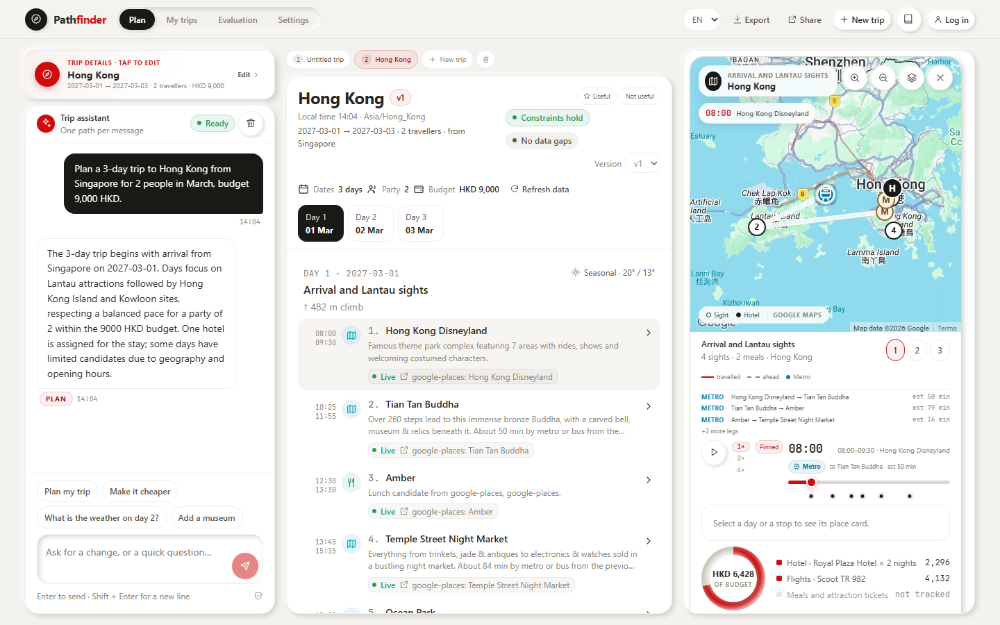

| Selected stop and map | Evaluation | Storybook Pathfinder |
|---|---|---|
| 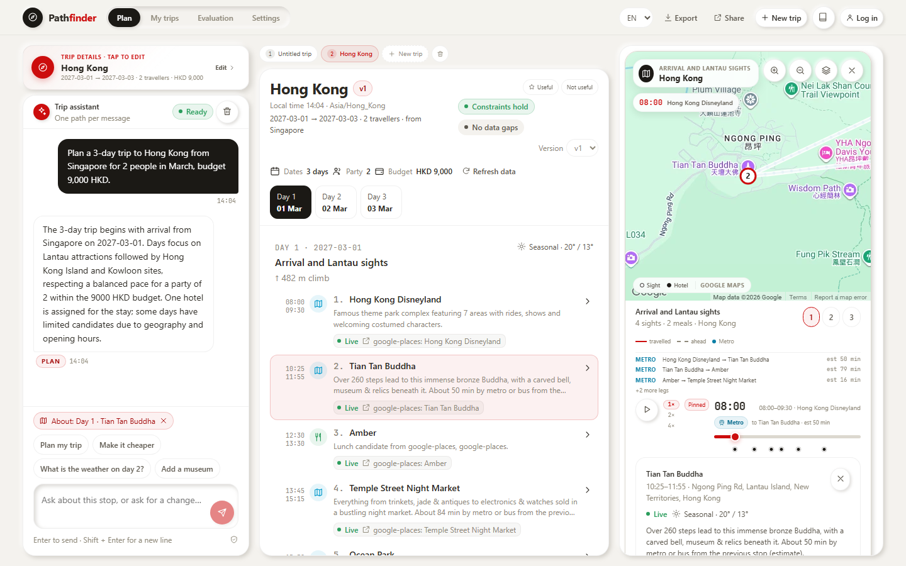 | 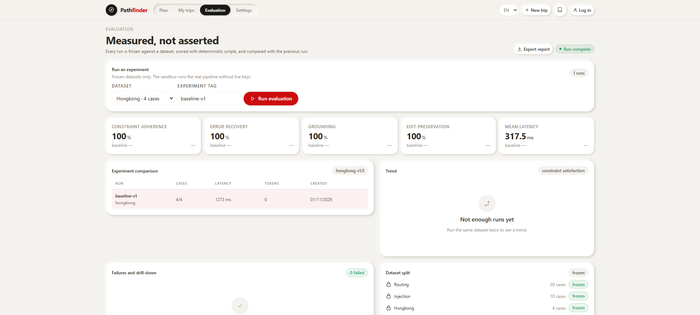 | 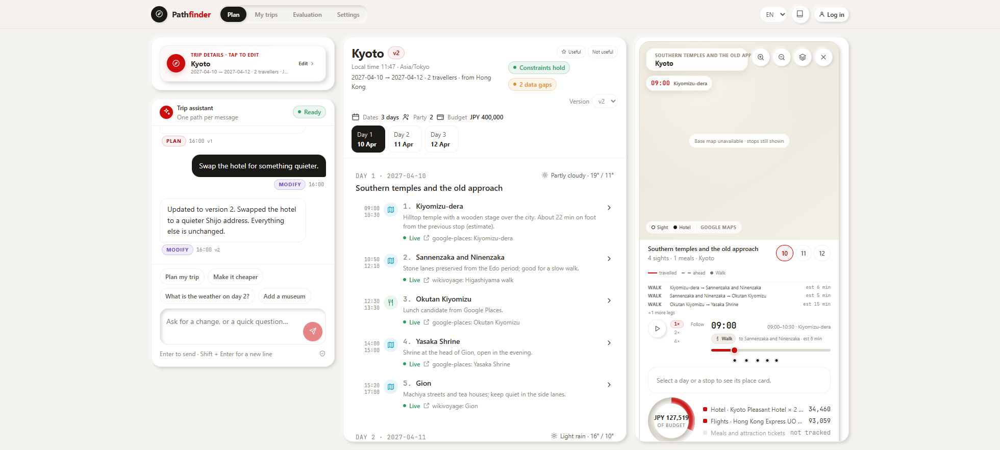 |

| Trip details open as a drawer | Changes called out in green |
|---|---|
| 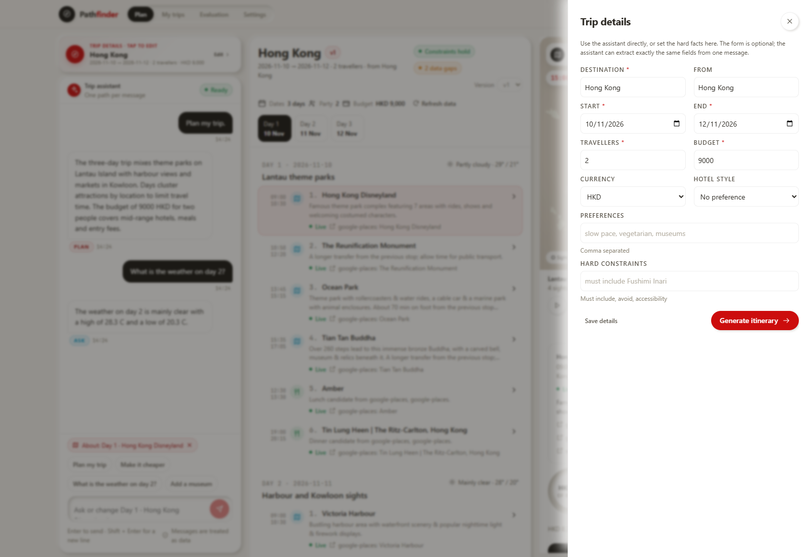 | 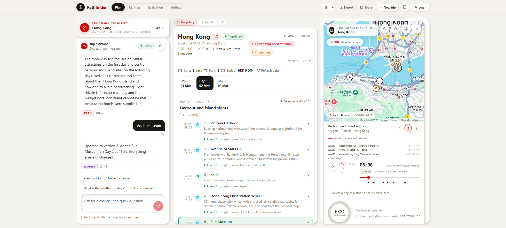 |

| Trending rail | Traveller token on a walking leg |
|---|---|
| 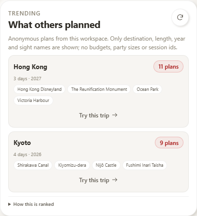 | 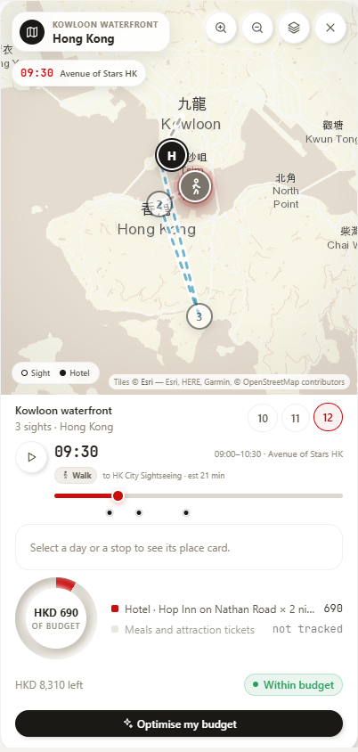 |

| Budget FX monitor | Map speed and moving token |
|---|---|
|  | 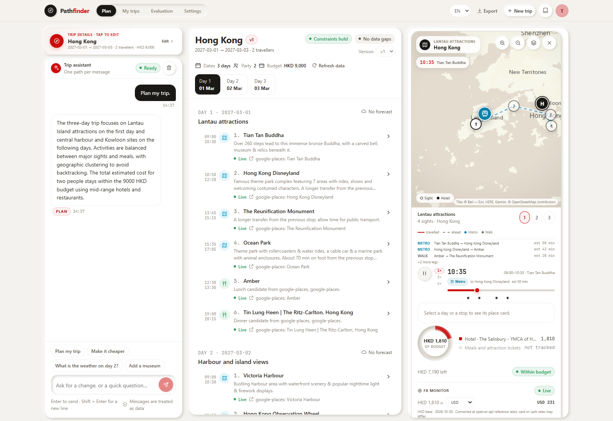 |

| Anonymous profile and tag-style preferences | Elongated middle column, rounded right column |
|---|---|
| 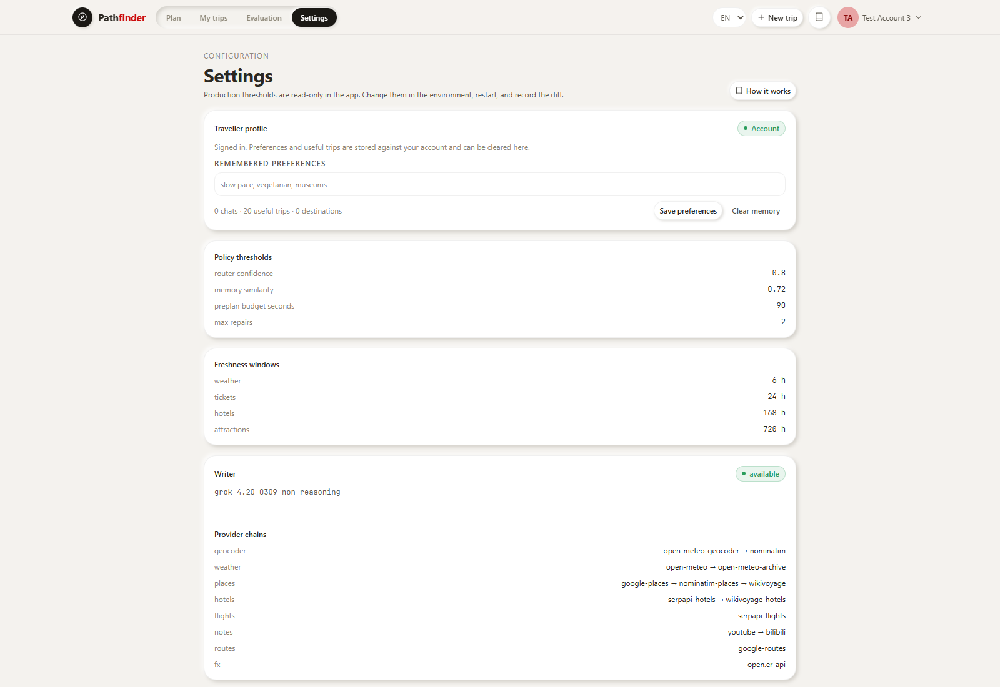 | 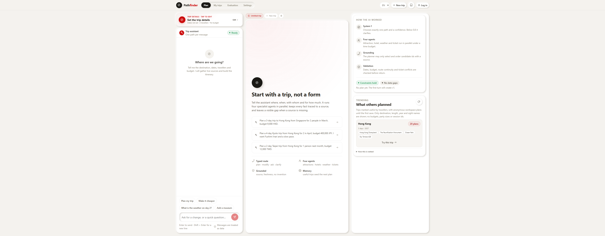 |

| Signed-in account | Marked useful → saved preferences |
|---|---|
| 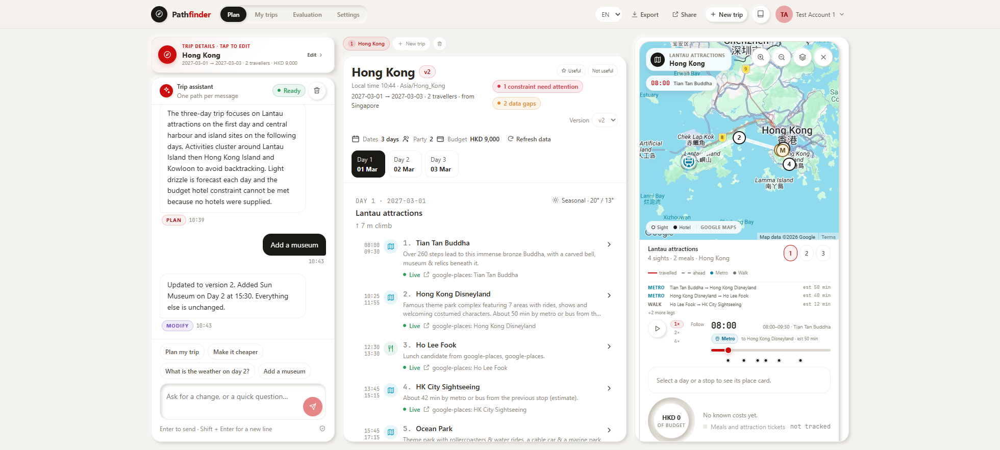 | 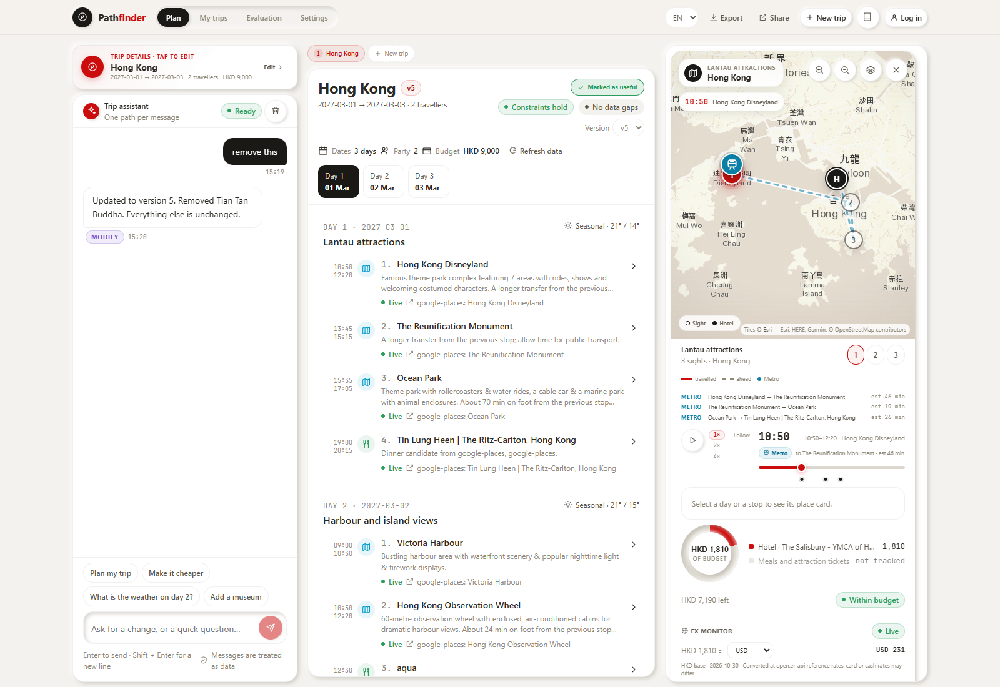 |

| Log in / create account | Local guide with citations |
|---|---|
| 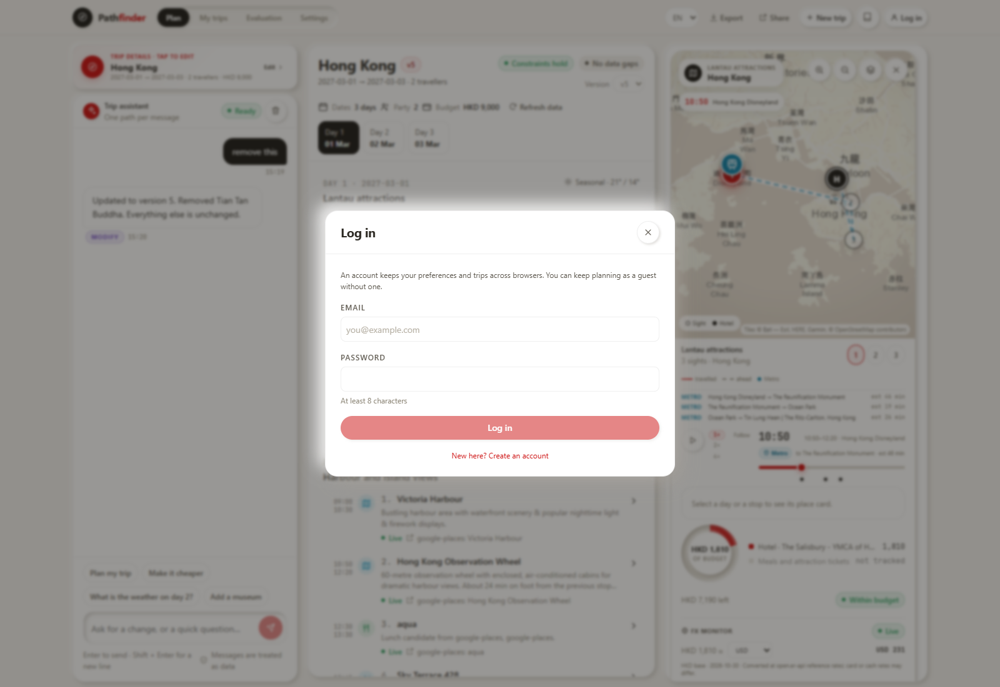 | 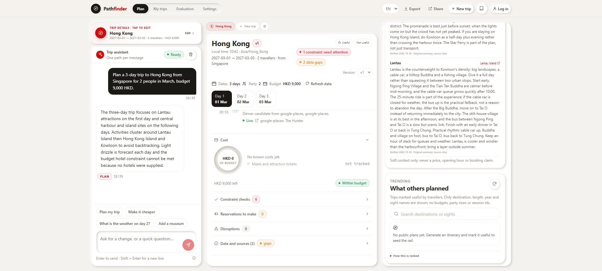 |

| Account menu | Signed-in profile |
|---|---|
| 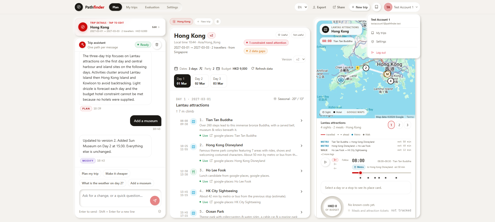 |  |

| Multi-plan tabs | Useful/not-useful at top right |
|---|---|
| 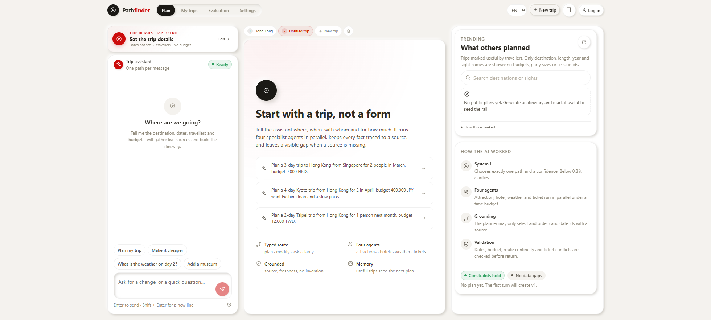 |  |

---

## 1. What is inside

| Layer | Stack | What it does |
|---|---|---|
| **Storybook Pathfinder** | React 18 + TypeScript + Storybook 8 | The design system built first: tokens, atoms, elements, molecules, organisms, templates. |
| **Frontend** | React 18 + Vite + TypeScript + Google Maps | The console, composed only from Storybook components. English-first UI with Simplified/Traditional Chinese as supplemental locales. Default currency **HKD**; budget FX monitor with live/static conversion. |
| **Backend** | FastAPI + Pydantic v2 + SQLite | Typed routing, four concurrent agents, grounded planning, bounded repair, SSE streaming, memory, evaluation. |
| **Contracts** | `contracts/openapi.json`, `contracts/trip_plan.schema.json` | The only backend ↔ frontend coupling. Regenerate with `python -m app.export_contracts`. |

There is no agent framework (no LangChain / LlamaIndex / CrewAI). Prompts, tool calls,
retries, budgets and validation are our own code.

### The one invariant

> The planner may **select and order** verified candidates. It may never **create** one.

An item without a source URL is rejected by the domain model. A model repair may not
introduce a new place or a new source URL. If a source is missing, the section is
`unavailable` and the gap is shown.

---

## 2. Run it

### 2.1 Prerequisites

- Python **3.11+** (developed on 3.13.7)
- Node **18+** and npm (developed on Node 24.19 / npm 11.17)
- Reference versions: FastAPI 0.141, Pydantic 2.11, httpx 0.28, uvicorn 0.47,
  React 18.3, TypeScript 5.6, Vite 5.4, Storybook 8.6.

### 2.2 Configure

```bash
cp .env.example .env
```

Fill the keys you have. Nothing is mandatory: with no keys the backend still starts,
the four agents mark their sections unavailable and the planner returns an honest,
source-grounded plan with visible gaps. `.env` is git-ignored and is not part of this
repository; create it from `.env.example` on each machine.

The writer is OpenAI-compatible. The reference configuration uses xAI
`grok-4.20-0309-non-reasoning` — the low-latency general model measured for interactive
turns. DeepSeek, xAI or any chat-completions endpoint works by changing
`LLM_PROVIDER`, `LLM_BASE_URL`, `LLM_API_KEY`, `LLM_MODEL`.

`WIKIMEDIA_USER_AGENT` is preset with a contact URL and framework name. Wikimedia refuses
a generic crawler string with HTTP 403; keep this value descriptive if you fork the
project.

### 2.3 Backend (port 8100)

```bash
python -m venv .venv
# Windows: .venv\Scripts\activate
# POSIX:   source .venv/bin/activate
pip install -r backend/requirements.txt
# optional local hybrid RAG (BGE-small + optional BGE reranker)
pip install -r backend/requirements-rag.txt

PYTHONPATH=backend python -m uvicorn app.main:app --port 8100
```

Windows PowerShell:

```powershell
$env:PYTHONPATH = "backend"
python -m uvicorn app.main:app --port 8100
```

Check: <http://127.0.0.1:8100/api/ready> · Swagger: <http://127.0.0.1:8100/docs>

### 2.4 Frontend (port 5173)

```bash
cd frontend
npm install
npm run dev
```

Vite proxies `/api` to `http://127.0.0.1:8100`; override with `VITE_API_TARGET`.

For a single-origin build:

```bash
cd frontend
npm run build          # writes frontend/dist
```

The backend serves `frontend/dist` automatically when it exists, so
<http://127.0.0.1:8100> is the whole application.

### 2.5 Storybook Pathfinder (port 6006)

```bash
cd frontend
npm run storybook          # design-system workbench
npm run build-storybook    # static build in frontend/storybook-static
```

The Storybook is the contract for the frontend. It was built before any application
screen; the app imports the same components rather than restyling them.

### 2.6 Demo accounts

Local-only accounts created for testing:

| Email | Password | Name |
|---|---|---|
| `testaccount1@pathfinder.test` | `Pathfinder123!` | Test Account 1 |
| `testaccount2@pathfinder.test` | `Pathfinder123!` | Test Account 2 |
| `testaccount3@pathfinder.test` | `Pathfinder123!` | Test Account 3 |

Any valid email address — including a Gmail address — can register with the normal
email/password form. **Sign in with Google** is a separate OAuth integration; it needs a
Google OAuth client ID and is not enabled yet.

They are seeded through the normal registration endpoint. Change `AUTH_SECRET`, use real
passwords, and remove these rows before any public deployment.

---

## 3. The turn pipeline

```
POST /api/turn/stream (SSE)
  screen (injection flags, aggregate log)
  → understand (rules first; model fills only missing slots)
  → route (typed: intent, confidence, need_clarification, reason, affected_parts)
  → gate (threshold 0.8; missing slots; plan required for modify)
  → ONE path:

  plan    memory recall → 4 agents in parallel under a deadline
          → planner (selects/orders candidate ids) → validators → ≤2 repairs
  modify  typed change → only affected agents → merge preserving locked/confirmed
          → recalculate cost/constraints → version + 1
  ask     answer from the current plan first → else at most one allowlisted tool
  clarify one short question about the missing slots; no tools, no planning
```

### The four agents

| Agent | Owns | Fallback |
|---|---|---|
| **Attraction** | Places, coordinates, ratings, hours, dining candidates, community notes | Google Places → Nominatim OSM → Wikivoyage; `unavailable` if none |
| **Hotel** | Candidates with price, rating, distance to centre | SerpApi Google Hotels → Wikivoyage Sleep; `unavailable` |
| **Weather** | Daily forecast for the exact trip dates | Open-Meteo; dates beyond the horizon become `unavailable`, never a fabricated temperature |
| **Ticket** | Flights with reference fares; reservation flags | SerpApi Google Flights; rail is explicitly not connected |

All four run concurrently. A slow or failing agent marks only its section
`unavailable`; the turn still returns inside `PREPLAN_BUDGET_SECONDS`.

### How a day is laid out

The planner chooses *which* verified stops belong to a day; the scheduler owns the clock:

- **Stops are chronological.** Meals sit at their real time (lunch 12:30, dinner 19:00),
  never appended after the afternoon.
- **Transfers are mode-aware.** Each leg is classified by distance — walk under 2.5 km,
  metro/bus under 35 km, car under 160 km, otherwise flight — and the next stop starts
  after that ride plus a pace buffer. The itinerary note names the mode, matching the
  map legend; nothing claims a multi-kilometre walk.
- **The map follows the real roads.** `GET /api/journeys/{id}/segments` returns the provider's
  route geometry for every leg of a day — **hotel → first stop, every stop → stop
  (restaurants included), last stop → hotel** — and the console draws those polylines and
  moves the traveller along them. A straight dashed line appears only when the provider
  returns nothing for that pair.
- **Pace shapes the day.** `slow pace` → at most 3 stops, 2 h each, 15 min of slack;
  balanced → 4 stops; fast → 5. Empty days are rebalanced so a day is not left with one
  stop while another has three.
- **Early slots are data-driven, not site-specific.** The first stop opens the day at
  08:00 when the traveller named it (`I want Fushimi Inari` → `must-see:` preference), when
  the source says it opens by 08:30, when its review count marks it as a place crowds
  build at, or when four stops have to fit. The same rule works in any city.
- **No repeat stops.** Near-duplicate candidates ("Arashiyama" vs "Arashiyama Bamboo
  Forest") are collapsed, while genuinely different places ("Kyoto National Museum" vs
  "Kyoto Railway Museum") are kept.

### Security boundary

- User text is fenced as data; it never becomes an instruction.
- A blocklist screens prompt overrides, hidden-instruction requests and smuggled tool
  calls. Suspected injections are logged as **category + count only**.
- Each path has an allowlist (`PATH_ALLOWLIST` in `application/toolbox.py`). `ask` can
  never run a pre-planning agent.
- A canary token is planted in every system prompt; any output containing it is blocked.
- The agent never books, pays, cancels or reads an account.

---

## 4. Clean architecture

```
backend/app/
├── domain/          entities, enums, errors, provider + repository ports
├── application/     use cases: understand, route, agents, planner, modify, ask,
│                    clarify, memory, validation, evaluation, orchestrator
├── infrastructure/  OpenAI-compatible writer, Jev, data providers, SQLite,
│                    tracing, FX, prompt loading
├── interface/       FastAPI routes, SSE, request/response models
├── security/        blocklist, fence, canary
└── container.py     composition root; the only place that wires concretes
```

Rules enforced by the structure:

- `application/` imports `domain/` only; it never imports FastAPI, SQLite or a vendor SDK.
- `infrastructure/` implements the domain ports; replacing a source is one class plus one
  registration line in `providers/registry.py`.
- `interface/` contains no business logic; it maps HTTP/SSE to the orchestrator.
- Every external call goes through `Toolbox`, which enforces the path allowlist and logs
  the call.
- One turn is one trace: JSONL in `data/traces/` and Langfuse when configured.

Details: [`docs/ARCHITECTURE.md`](docs/ARCHITECTURE.md). The A-grade gap analysis against
comparable GitHub projects (RAG, reranking, route optimization, sharing) is in
[`docs/GAP_ANALYSIS.md`](docs/GAP_ANALYSIS.md).

---

## 5. Data and truthfulness

| Fact | Source | Truth label |
|---|---|---|
| Attractions, ratings, hours | Google Places (New) | live when key works; `unavailable` otherwise |
| Attraction fallback | Nominatim OSM → Wikivoyage (compliant Wikimedia User-Agent) | guide/OSM listings; no live hours |
| Hotels | SerpApi Google Hotels | **reference** nightly rate, availability not confirmed |
| Hotel fallback | Wikivoyage Sleep | guide listing, reference price |
| Flights | SerpApi Google Flights | **reference** fare for the travelling party |
| Weather | Open-Meteo | forecast, 16-day horizon |
| Weather beyond horizon | Open-Meteo Archive | 3-year seasonal reference, marked `stale`, never a forecast |
| Notes | YouTube Data API, Bilibili | community, last 24 months, lower trust |
| FX | open.er-api.com (12 h cache) | live reference + dated static fallback; HKD default |
| Map base | Google Maps everywhere | browser key served by `/api/runtime`; contextual, not navigation |
| Map time | plan item `start`/`end` | 06:00–23:00 scrubber, play/pause, 1×/2×/4× speed, current-stop HUD |
| Map route key | per-leg distance estimate | travelled/ahead line style, mode colours, leg list |
| New trip / export | session + plan | scrap the old session and local pointer; Markdown export |
| Map token mode | distance estimate from verified coordinates | walk / metro / drive / flight, labelled `est` |
| Trending | trips marked useful, retrieved by hybrid BM25 + dense search | destination, days, year and sight names only |
| Profile / memory | random browser token or email account | preferences, saved-trip count, recent destinations |
| Auth | email + password + HS256 token | optional; guest mode still works |
| Plan tabs | localStorage session list | up to several open trips; switch without regenerating |
| Feedback | top-right of the itinerary | 1–5 stars, useful/not-useful, green saved animation |
| Shared trip | signed-in or guest plan | read-only page; budget, party size and session id redacted |
| Local guide RAG | 10 versioned documents (HK, Japan, USA) + citations | never used for price, hours or booking facts |
| Route order | open-path 2-opt on the chosen day stops | synthetic benchmark: avg 91.7 km → 61.7 km (−32.7%) |
| Useful → preferences | feedback on a plan | tags derived from structured choices; green save animation |
| Map route | Google Routes | day route between sights; straight-line estimate fallback |

A gap is a **statement about the current plan**, not an append-only log. New versions
drop resolved gaps; duplicate/obsolete edit gaps are removed on reload. The common cases:

- `weather`: dates outside the 16-day forecast fall back to a three-year archive average,
  labelled `Seasonal`/`stale`. If the archive also has no rows, the gap names both dates
  and both windows.
- `tickets`: a departure city is now a required planning slot, so the assistant asks for
  it instead of leaving a ticket gap. Same-city trips skip flights with a note, not a gap.
  A round trip uses SerpApi's two-step flow (`departure_token`): the outbound and the
  inbound leg are shown on one option with one combined fare, never a departure alone.
- `attractions`: only a resolver failure that leaves no attraction is a gap. A failed
  higher-priority source with a working fallback (Google → Nominatim OSM → Wikivoyage)
  is not surfaced as a gap.

What the system deliberately does **not** do: invent a price, an opening hour, a flight
number or a restaurant. It also does not book. Unavailable sections stay visible.

---

## 6. Evaluation

```bash
cd backend
PYTHONPATH=. python -m app.eval_run --dataset hongkong --tag baseline-v1
PYTHONPATH=. python -m app.eval_run --dataset hongkong --tag improved-v2
PYTHONPATH=. python -m app.eval_run --dataset routing  --tag baseline-v1
PYTHONPATH=. python -m app.eval_run --dataset injection --tag baseline-v1
```

The harness runs the **real application pipeline** against a deterministic sandbox
provider registry, so a scored run needs no network and no model key. Datasets are
frozen before scoring; an unfrozen dataset is refused.

The soft-guide corpus is ten versioned Markdown documents covering Hong Kong,
Japan and the USA. Each has a citation, licence, `last_verified` date, content
hash and corpus version. Details and the quarterly update policy:
[`docs/RAG_CORPUS.md`](docs/RAG_CORPUS.md).

```bash
cd backend && PYTHONPATH=. python -m app.guide_eval
# {'cases': 30, 'top1': 1.0, 'mrr': 1.0, 'cross_destination_noise': 0}

PYTHONPATH=. python -m app.guide_ablation
# lexical 0.9167 Top1 → BM25/dense/hybrid 1.0;
# BGE reranker 1.0 but 263.9 ms vs 10.8 ms hybrid — no gain on this corpus
```

The default guide path is **BM25 + BGE-small hybrid**; the BGE cross-encoder is
opt-in (`/api/handbook?...&rerank=true`) and stays off until a larger, harder
corpus shows a gain. Jev is still the System 1 router, not a reranker.

```bash
cd backend && PYTHONPATH=. python -m app.route_bench
# avg_before_km 91.681 → avg_after_km 61.696 (−32.71%) on 40 synthetic 6-stop days
```

The route pass is open-path 2-opt over the day's chosen stops; the benchmark is synthetic,
not live-traffic evidence. Markdown/CSV export are built into the **Evaluation** tab.
Reports land in
`data/eval/<run_id>.md`.

The evaluation tab needs at least one run; after the two `hongkong` commands above it
shows a real comparison and a trend line. Full method and current results:
[`docs/EVALUATION.md`](docs/EVALUATION.md).

---

## 7. Tests

```bash
cd backend
PYTHONPATH=. python -m pytest
```

The suite is offline and covers: injection screen/fence/canary, typed routing and the
confidence gate, grounded planner composition, minimal hotel edit with preserved stops,
allowlist enforcement, memory cutoff, the evaluation harness, and the HTTP/SSE surface.

```bash
cd frontend
npm run typecheck
npm run build
npm run build-storybook
```

Verified in this workspace: **61 backend tests pass**, TypeScript is clean, the app
builds, and Storybook builds. Live end-to-end turns were exercised against the real
APIs (plan, ask, hotel swap) and captured in `docs/screenshots/`.

---

## 8. Demo walkthrough

See [`docs/DEMO.md`](docs/DEMO.md). The two-minute path:

1. **Plan** — fill Kyoto, 10–13 Nov 2026, 2 travellers, 400,000 JPY → Generate.
   Watch the four agents, then the itinerary, map, sources and budget.
2. **Select** a stop → the map pin, place card and scope chip follow.
3. **Ask** “What is the weather on day 2?” → answered from the plan, no re-planning.
4. **Modify** “Swap the hotel for the other option.” → only the hotel agent reruns;
   version becomes 2; every stop is preserved.
5. **Evaluation** → run `hongkong` twice, compare metrics, open a failed case, export.
6. **Settings** → thresholds, freshness windows, provider chains, aggregate injection log.

---

## 9. Known limitations (declared, not hidden)

- **No booking and no live inventory.** Hotel/flight prices are reference figures. The
  user completes the purchase.
- **A budget request is an honest search, not a guarantee.** "Cheaper"/"optimise the
  budget" re-runs the hotel and flight agents, keeps the cheapest verified combination,
  and — when it is still over — states the cheapest total, how far over it is, and which
  line dominates (usually flights). It never deletes confirmed stops or invents a price.
  A round-trip flight search costs up to four SerpApi calls (one outbound list plus one
  `departure_token` call per shown option).
- **Rail is not connected to a live schedule.** The ticket agent says so; it does not
  estimate a fare.
- **Weather beyond ~16 days** is not a forecast. It is filled from a three-year
  archive average, explicitly labelled `Seasonal` and `stale`; if the archive also has
  nothing, the gap explains the date range and both failed windows.
- **Long-term memory is SQLite + a deterministic hashed embedding**, not pgvector. It is
  a deliberate single-node trade-off; weak matches are excluded by the cutoff.
- **The map is contextual, not a navigation map.** Google Maps is the single base map
  everywhere, including Hong Kong and mainland China. The day route uses the routes
  provider's real geometry (plus the hotel legs and restaurant stops) and only falls back
  to a straight line when no route comes back. Playback follows the vehicle and rolls into
  the next day on its own. Tile requests need network; if the base fails, pins and route
  still render on paper. One browser key (`GOOGLE_MAPS_API_KEY`) is served by
  `/api/runtime`; the backend never calls a map vendor.
- **Transport modes on the map are estimates** from straight-line distance, not live
  routing. The token switches walk/metro/drive/flight and every leg labels `est`;
  flight appears on long intercity legs (>160 km), so a single-city plan normally shows
  walk, metro and drive.
- **Trending is workspace-local and retrieval-based.** Only trips marked useful are
  indexed; a query, the current destination and the caller's own preference tags are run
  through BM25 + a dense vector, fused with reciprocal rank fusion, then aggregated into
  cards. It exposes no owner, budget, party size, session id or other traveller's
  preferences. Seed a platform-sized corpus with
  `backend/scripts/seed_platform_demo.py`; see `docs/TRENDING_RAG.md`.
- **Profile works logged-out or logged-in.** Guests use a random browser token; email
  accounts are optional and take over the guest's preferences and saved trips on first
  login. Saved trips, preferences and planner recall are per profile: nobody sees or
  recalls another traveller's. Clearing memory removes only the caller's saved trips and
  preferences; clearing chat removes messages but keeps the current plan. **New trip** deletes the current session row and local pointer, so a stale
  `pathfinder.session` cannot pin the console to an old plan.
- **Export** writes Markdown from structured fields and sources, not a model transcript.
- **Local-guide RAG is a lexical baseline.** It is destination-filtered and cited, and the
  eval set reports Top1/MRR/noise; an embedding/cross-encoder reranker (including Jev) is
  still a measured next step, not a claim.
- **Share links are public and currently permanent.** Redaction removes budget, party size,
  session id and client token; link revocation and comments remain roadmap.
- **Auth has no password reset or email verification yet.** Passwords use scrypt and tokens
  are HS256 JWTs; change `AUTH_SECRET` outside a local demo.
- **Origin is required for planning.** It is a gate slot, so a plan without a departure
  city asks for it instead of silently skipping tickets.
- **Evaluation runs are sandboxed** for determinism. They exercise the real pipeline,
  not live providers; live behaviour is captured separately in traces and screenshots.
- **Chinese locales are supplemental.** The product, prompts, plan narrative and traces
  are English-first; the Chinese dictionaries cover the console chrome, not every
  generated sentence.
- **No authentication.** The first release uses an anonymous browser session. Admin
  endpoints use a local token; change it before exposing the process.
- **Policy thresholds are environment-configured.** The Settings screen is intentionally
  read-only; changing a threshold means editing `.env`, restarting and recording the diff.

---

## 10. Repository map

```
Pathfinder_v1/
├── backend/
│   ├── app/                 layered application (domain → application → infrastructure → interface)
│   ├── tests/               offline pytest suite
│   └── eval/fixtures/       routing, injection, HK, Japan, TravelPlanner fixtures
├── frontend/
│   ├── src/design-system/   Storybook Pathfinder: tokens, components, stories, fixtures
│   ├── src/app/             application pages
│   ├── src/lib/             API client, session hook, i18n
│   └── .storybook/          Storybook configuration
├── contracts/               OpenAPI + TripPlan JSON Schema
├── docs/                    spec, architecture, API, design, evaluation, demo
├── samples/                 ordinary, changed and failure-case inputs
├── scripts/                 dev helpers
├── .env.example
└── README.md
```

---

## 11. Non-functional targets

| Target | Value | How it is enforced |
|---|---|---|
| Turn latency | interactive: typical live plan 12–20 s | fast writer model; agents parallel; budget 90 s |
| Agent deadline | 30 s each | `asyncio.wait_for` + overall `asyncio.wait` |
| Repair bound | 2 | `MAX_REPAIRS`; then a typed error, never a dirty plan |
| Routing gate | 0.8 | configurable; below it the turn clarifies |
| Memory cutoff | 0.72 | configurable; weak matches are not injected |
| Freshness | weather 6 h, tickets 24 h, hotels 7 d, attractions 30 d | timestamps on every item |
| Privacy | no identity data in long-term memory | schema + aggregate injection log |
| Observability | one trace per turn | JSONL always; Langfuse when keys are set |

---

## 12. AI use

AI-use declaration: [`docs/AI_USE.md`](docs/AI_USE.md).  
Functional baseline: [`docs/SPEC.md`](docs/SPEC.md).

Credentials are not part of the submission. `.env` is ignored; `.env.example` documents
every variable. Regenerate contracts and screenshots rather than committing secrets.
