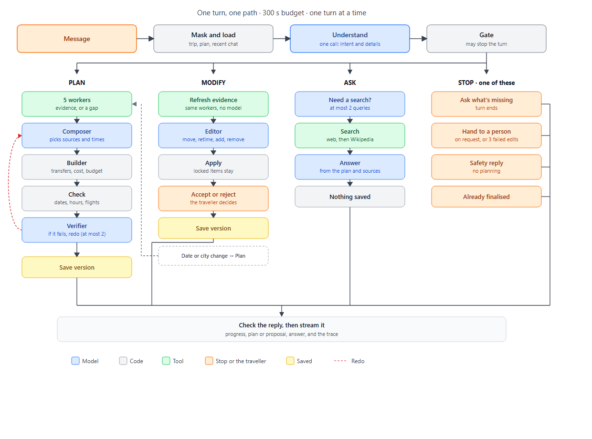
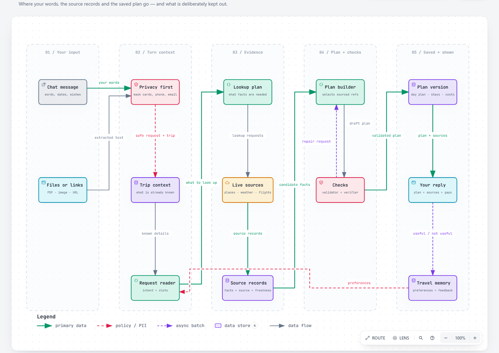
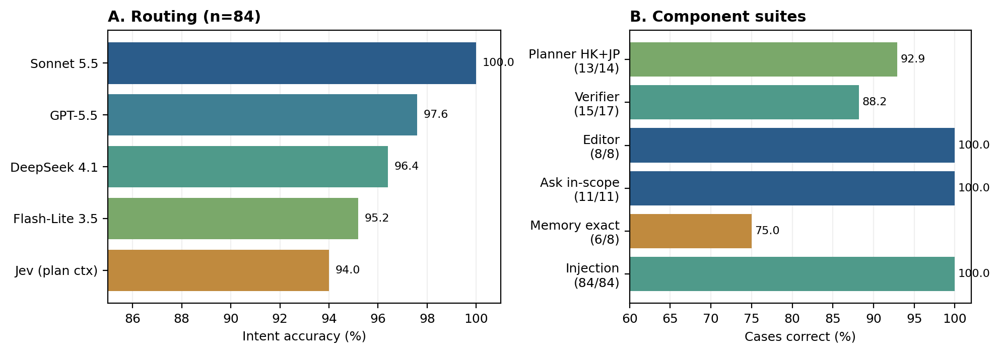
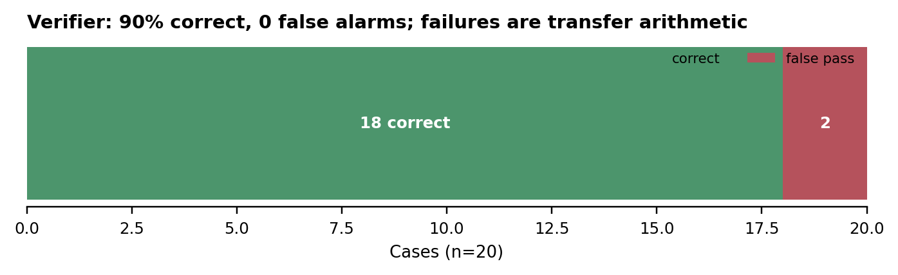
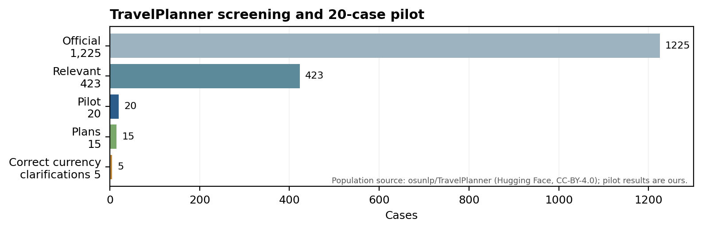

# Pathfinder v5

A conversational, state-aware trip planner. **The Pathfinder interface, with a
rebuilt LLM-first core.** The React app in `frontend/` carries the latest workspace
design — map stage, day panel and draggable day rail, compact toolbar, and the
centered adaptive trip-details dialog — while the backend behind `/api` is rebuilt
around a typed turn analyst, sourced evidence, bounded repair and versioned plans.

**Latest:** the submitted patch is **v5.2.11** (tag `submission-v5.2.11`); the
version table below records the earlier milestones. The Models tab configures a
model, temperature, reasoning effort and reply cap for each part; the turn router
can be the LLM router or Jev (System 1); handoff goes to a real human-in-the-loop
desk queue with independent switches. See
[docs/VERSION_NOTES.md](docs/VERSION_NOTES.md) — it also imports the `main` v1.x
release notes and maps each one to what v5 kept, changed, or deliberately dropped.

**Constraint verifier:** by default it uses `deepseek-flash` at
`https://api.deepseek.com/v1`, temperature 0 and a 1,500-token cap. It has its own
`VERIFIER_API_KEY` so it is not tied to the writer provider. The Settings **Models by
part → Constraint verifier** field can override the model; all other parts still share
the active writer key. With no verifier key it falls back to the default writer.

## Submission package

**Submitted version:** **v5.2.11**, branch `pathfinder_v5`, annotated tag
`submission-v5.2.11`. The tag marks the exact submitted commit:
`git show submission-v5.2.11` displays its message and commit.

This is a complete runnable application, not a notebook. The entry point is the
FastAPI app `backend/app/main.py` (`app.main:app`); it serves the built React UI
from `frontend/dist` and the `/api` routes from the same process.

| Requirement | Where it is covered |
|---|---|
| Clear entry point and run command | `backend/app/main.py`, [Quick start](#quick-start), `start.ps1` / `start.cmd`, direct `uvicorn` command below |
| Setup, run and evaluation commands | [Quick start](#quick-start), [Evaluation](#evaluation) |
| Dependency versions | [Dependency versions](#dependency-versions) and [docs/submission/REFERENCES.md](docs/submission/REFERENCES.md) |
| Model settings | [Model settings](#model-settings); defaults in `backend/app/config.py`, `backend/app/core/llm.py`; overrides in `.env.example` |
| Data and service requirements, paid access, hardware | [Data, services and hardware](#data-services-and-hardware) |
| Sample inputs: ordinary, changed, failure | [docs/submission/CODE_AND_CHECKS.md](docs/submission/CODE_AND_CHECKS.md) (one of each), inputs in `docs/submission/*.txt` |
| Evaluation scripts and results | [Evaluation](#evaluation), `backend/scripts/run_eval.py`, [docs/EVALUATION.md](docs/EVALUATION.md), [docs/eval-artifacts/v5-model-study/RESULTS.md](docs/eval-artifacts/v5-model-study/RESULTS.md) |
| Prompts and configuration | `backend/app/skills/*.md`, `backend/app/core/prompts.py`, `backend/app/config.py`, `.env.example` |
| Success/failure traces | [docs/submission/TRACES.md](docs/submission/TRACES.md), `docs/submission/traces/success-taipei-turn-log.json`, `docs/eval-artifacts/v5-model-study/TRACE_INDEX.md` |
| Credentials, mocks and transparency | [Access, transparency and AI assistance](#access-transparency-and-ai-assistance); [Mocked and demo-only functions](#mocked-and-demo-only-functions); `.env.example`; `.env` is ignored |
| Known limits (language, multi-city, long days) | [Known limits](#known-limits) |
| AI assistance declaration and prompt record | [docs/submission/AI_ASSISTANCE.md](docs/submission/AI_ASSISTANCE.md) |

## Version notes

**v1.0.0 → v1.19.0 — 2026-11-01 to 2026-11-23 12:45 HKT (summarised).**
The legacy `main` line grew from the renamed, migrated prototype in v1.0.0 into a
complete product: identity and accounts, web search and reviews, plan / edit / clarify
turns, maps with transit, ferry and walking comparisons, budgets and currency
conversion, live flight evidence, PDF and image intake, multi-city routes, lockable
stays and legs, the studio UI and Export menu, three routing gates, a human-in-the-loop
desk with three escalation paths, traveller memory and profiles, and privacy masking.
It was checked with the offline `pytest` suite, frontend typecheck and production
build, Storybook, CI, the frozen routing / injection / Hong Kong / Japan / TravelPlanner
/ efficiency / edit-vs-replan evaluation suites, and live smoke turns. The legacy line
retained known limits (ground transport estimates, incomplete source coverage, and a
small set of stale test gaps); it is archived and is not rebuilt by v5.

> **New design direction.** After v1.19.0, the v5 redesign was proposed to handle more
> complex and ambiguous requests, and to give the runtime better context management:
> typed state, date windows, bounded execution, ordered city segments, sourced
> evidence, and explicit clarification rather than a longer prompt.

| Version | When (HKT) | Commits | Headline |
|---|---|---|---|
| **v5.1.1** | 2026-11-23 15:43 | `2d6d7c3`…`ebe064e` | Selected-item context, current-hotel locking, verifier visibility, DeepSeek verifier benchmark, and DeepSeek Search as the final web fallback |
| **v5.1.0** | 2026-11-23 14:16 | `4995ec9`…`152fd51` | Complex requests get explicit state: date windows, flight buffers, a whole-turn budget, ordered multi-city segments, a runtime clock, split LLM/Jev confidence settings, and the complete architecture reference |
| **v5.0.0** | 2026-11-23 11:47 | `fabeb36`…`e72cfff` | LLM-first core behind the unchanged React UI: typed analyst/router, evidence workers, sourced-only planner, deterministic validation, bounded repair, versioned plans, per-part models, optional Jev and a real HITL queue |

The detailed patch notes, including every commit and the part-model study, are in
[docs/VERSION_NOTES.md](docs/VERSION_NOTES.md). `v5.0.0` is the first v5 release;
`v5.1.0` introduced the complex-request line; `v5.1.1` was the last milestone
before the submission patch **v5.2.11**.

## What kind of agent is this?

In **COMP7608B** terms, Pathfinder v5 is an **LLM-based agentic system**: a
task-oriented, tool-using **planning agent** running under a bounded **runtime
harness**. One turn uses **routing**, **prompt chaining**, **parallelization** of
tool workers, an **evaluator–optimizer** repair loop, **skills** and **memory**, and
**human-in-the-loop** handoff. It is **not** an autonomous multi-agent swarm, and it
does **not** use a vector database/RAG for saved trips. The full mapping from course
terms (context builder, runtime/harness, observation, skill, memory types, HITL,
evaluation) to v5 code and UI is in
[docs/AGENT_TERMINOLOGY.md](docs/AGENT_TERMINOLOGY.md).


```
traveller message
   │
   ├─ intake         files / links → trip facts
   ├─ understand     ONE model call → typed intent + slots + constraints + clarify
   │
   ├─ plan    agents (places · hotels · weather · tickets)  →  composer  →  validator  →  repair ≤2
   ├─ modify  agents (same evidence) → typed edit ops → validate → proposal ticks
   ├─ ask     retrieve → answer with sources
   └─ unclear clarify
   │
   └─ versioned TripPlan (SQLite) → SSE → the same React UI
```

## Architecture at a glance



The diagram follows one turn: a message enters, the analyst reads it, the turn
branches into **plan**, **modify**, **ask** or **stop**, and the result is
checked before it is saved or streamed. Code and model boundaries are marked;
the turn budget and one-turn-at-a-time seat are part of the same picture.

The technical map is [docs/ARCHITECTURE.md](docs/ARCHITECTURE.md); the diagram
source image is
[docs/architecture/pathfinder-v5-one-turn.png](docs/architecture/pathfinder-v5-one-turn.png).

**Data flow:** where your words, the source records and the saved plan go, and what is
deliberately kept out.



## Why a revamp

The `main` branch (v1.18.0) works, and its `backend/app` is 56,831 Python lines:
2,479 lines of slot extraction in `application/understanding.py`, 1,031 lines of
intent rules in `application/router.py`, and 861 `re.*` uses (233 `re.compile` calls)
across 63 files deciding what a traveller meant, what a slot is, whether an edit is
safe. That core is fast and brittle — it caps intent accuracy at what the rules
anticipated and makes every new phrasing a new rule.

v5 moves the judgement into a model and keeps the *contract* in code:

| Job | main (v1.18.0) | v5 |
|---|---|---|
| What does the traveller want? | rules first, model fallback | **one typed model call** (`app/skills/understand.md`) |
| Slots, dates, constraints | regex + gazetteers | model + calendar arithmetic in code |
| Which places to include | templates + rules | model chooses **refs** from sourced candidates |
| Facts in the plan | mixed | **copied from evidence by code** |
| Edit scope | rules | model returns **typed ops**, code applies them |
| Safety | rules + model | schema + canary fence + grounded facts |
| Repair | bounded | bounded, with the validator's exact problems fed back |

There is **no regex-based understanding** anywhere in v5: `understand/` has no `re`
import, and the whole backend uses `re` in just two redaction controls
(`security/pii.py` and the admin preview endpoint) — 9 uses in 2 files. Structured
values such as `10:00-23:00` opening hours are parsed with string operations in
`plan/validator.py`, not regex.

Measured on the checked-out trees (23 Nov 2026):

| Measure | main (v1.18.0) | v5 |
|---|---:|---:|
| Python lines in `backend/app` | 56,831 | 11,990 |
| Python files | 148 | 43 |
| Files using `re.*` | 63 | 2 |
| `re.compile` calls | 233 | 4 |
| FastAPI route handlers | 100 | 98 |
| Test functions | 2,326 | 52 |
| Frontend source lines | 39,146 | 39,362 |
| Prompt packs | 24 `SKILL.md` (857 lines) | 7 (471 lines) |

The 98 v5 handlers are 95 decorated routes plus three dynamic suggestion routes; the
two missing from v5 are the SPA catch-all (replaced by a static mount) and the admin
trace-span reader. The frontend differs in 17 of its 118 main-branch source files,
plus one new Models settings file (574 lines added, 610 removed), mostly the settings
surface and its copy. The test gap is the honest cost of the rewrite: 52 test
functions against main's 2,326.

## Quick start

Requirements: Python 3.11+ (3.13.2 tested), Node 20.19+ only if you rebuild the UI.
No GPU is used; model inference is remote. The SQLite database lives under `data/`.

```powershell
cd "Pathfinder v5"

# First run only: create the environment and install runtime + test dependencies.
python -m venv backend\.venv
.\backend\.venv\Scripts\python.exe -m pip install -r backend\requirements.txt -r backend\requirements-dev.txt

copy .env.example .env      # then add a writer key (Poe, OpenAI, xAI, …)

# Entry point: one process serves the API and the built UI.
.\backend\.venv\Scripts\python.exe -m uvicorn app.main:app --app-dir backend --host 127.0.0.1 --port 8100
```

Open **http://127.0.0.1:8100**. The convenience scripts wrap the same command
(`start.ps1` defaults to port 8101, so pass `-Port 8100` to match the command
above):

```powershell
.\start.ps1 -Port 8100      # API + built UI
.\start.cmd                 # same, default port 8101
```

The same process serves the API and the built UI (`frontend/dist`). Useful flags:

```powershell
.\start.ps1 -Sandbox        # curated place corpus: offline evidence + evaluation
.\start.ps1 -Port 8102
```

Without a writer key the app still starts and the Settings page explains what is
missing; planning turns answer that the model is not configured.

### Run with Docker

Docker needs no local Python or Node. The `Dockerfile` builds the React UI in a
Node stage, then runs the API and the built UI from one Python 3.13 container on
port 8100.

**1. Build the image** (from the repository root):

```bash
docker build -t pathfinder:v5 .
```

**2. Run it with one of these options.**

*Option A: default settings (no setup).* Then add your model key on the Settings
page (bring-your-own-key).

```bash
docker run --rm -p 8100:8100 -v pathfinder-data:/app/data pathfinder:v5
```

*Option B: your own `.env`.* Every value in it overrides the default.

```bash
cp .env.example .env        # then add a writer key (Windows: copy .env.example .env)
```

```bash
docker run --rm -p 8100:8100 --env-file .env -v pathfinder-data:/app/data pathfinder:v5
```

A single value can also be set with `-e`, for example `-e LLM_API_KEY=...`.

**3. Open http://localhost:8100.**

Notes:

- The default settings come from `.env.example` and are placeholders only, so no
  real API keys are in the image.
- The `pathfinder-data` volume keeps the SQLite database, traces and caches
  between runs; drop `-v …` for a throw-away container.
- Add `-e PATHFINDER_SANDBOX=1` for the offline place corpus (same as
  `start.ps1 -Sandbox`).
- Inside a container, browser requests arrive from the Docker network rather than
  `127.0.0.1`, so `LOCAL_ADMIN` does not grant operator access. Use the
  `ADMIN_TOKEN` from `.env` for the operator pages, and change `ADMIN_TOKEN` and
  `SECRET_KEY` before exposing the container beyond your own machine.

### Dependency versions

Tested versions for this submission (declared ranges are in
`backend/pyproject.toml` and `frontend/package.json`; the full table with upstream
links is in [docs/submission/REFERENCES.md](docs/submission/REFERENCES.md)):

| Layer | Tested |
|---|---|
| Python | 3.13.2 (requires 3.11+) |
| FastAPI / Uvicorn | 0.165.0 / 0.54.0 |
| httpx / Pydantic / pydantic-settings | 0.28.1 / 2.14.4 / 2.16.3 |
| pypdf / tzdata | 6.21.4 / 2026.6 |
| Node / npm | 24.19.0 / 11.17.0 (requires Node ≥ 20.19) |
| React / Vite / TypeScript | 18.3.1 / 5.4.21 / 5.9.3 |
| Storybook / pptxgenjs / roughjs / perfect-freehand | 8.6.19 / 4.0.1 / 4.6.6 / 1.2.3 |

Development dependencies `pytest>=8` and `pytest-asyncio>=0.24` are in
`backend/requirements-dev.txt`; install both files with the command above before
running the test suite.

### Development UI

```powershell
cd frontend
$env:VITE_API_TARGET = "http://127.0.0.1:8101"   # main's dev server defaults to 8100
npm run dev
```

The Vite config already proxies `/api` and honours `VITE_API_TARGET`.

### Rebuilding the UI

```powershell
cd frontend
npm install
npm run build
```

On Windows, esbuild sometimes cannot delete its own temp file; point the build at a
local temp directory if that happens:

```powershell
$env:TEMP = "$PWD\.tmp"; $env:TMP = "$PWD\.tmp"; npm run build
```

## Configuration

Everything is read from `.env` by `backend/app/config.py`; `Settings.writer` resolves
the writer endpoint by `LLM_PROVIDER`:

| `LLM_PROVIDER` | block used |
|---|---|
| `openai` / `openai-compatible` / `chatanywhere` | `OPENAI_*` (falls back to `LLM_*`, then `POE_*`) |
| `xai` | `XAI_*` |
| anything else | `LLM_*` |

The important keys:

| Group | Keys | What it powers |
|---|---|---|
| writer | `LLM_*`, `OPENAI_*`, `XAI_*`, `POE_*` | every model call: understanding, planning, edits, answers, translation |
| places | `GOOGLE_PLACES_API_KEY`, `GOOGLE_MAPS_API_KEY` | attractions, hotels, restaurants, autocomplete, photos |
| travel | `SERPAPI_KEY`, `SERPAPI_KEY_POOL` | live flight fares, web search |
| search | `DEEPSEEK_SEARCH_API_KEY` | final web-search fallback after SerpAPI and Wikipedia |
| verifier | `VERIFIER_*` | constraint audit on its own DeepSeek endpoint |
| weather | none | Open-Meteo forecast |
| judge | none | removed from the v5 runtime; no key, method or call path exists |
| security | `CANARY_TOKEN`, `ADMIN_TOKEN`, `LOCAL_ADMIN` | injection fence, operator views |
| sandbox | `PATHFINDER_SANDBOX=1` | curated evidence, no network |

### Model settings

Defaults are in `backend/app/config.py` and `backend/app/core/llm.py`; every value
has an `.env` override. The Settings → **Models by part** dialog overrides the
writer/verifier model at runtime.

| Part | Default | Settings |
|---|---|---|
| Writer (understanding, planning, edits, asks, translation) | `claude-sonnet-5.5`, temperature `0.2` | `LLM_PROVIDER`, `LLM_MODEL`, `LLM_TEMPERATURE`, or the `OPENAI_*` / `XAI_*` / `POE_*` blocks |
| Router | the writer model, confidence gate `0.8`; optional Jev (`DECISION_*`, `JEV_API_KEY`) | `ANALYST_CONFIDENCE_THRESHOLD`, `JEV_CONFIDENCE_THRESHOLD`, `DECISION_ENABLED` |
| Constraint verifier | `deepseek-flash`, temperature `0`, 1,500-token cap | `VERIFIER_*` (falls back to the writer key if unset) |
| Plan answer budget | floor 8,000 tokens (4 days 9,000; 7 days 13,500; ceiling 16,000) | `PURPOSE_MAX_TOKENS` for the other parts; `MAX_REPAIRS` (default 2) |
| Turn budget | 300 s (60–900 allowed) | `TURN_DEADLINE_SECONDS`, `PREPLAN_BUDGET_SECONDS` |

The per-purpose caps are `planner 8000` (grows to 16,000 with trip length),
`editor 3000`, `analyst 3000`, `intake 6000`, `translation 4000`, `verifier
1500`, `ask 1400`, `memory 700`, `search_query 200`. No judge model exists;
evaluation scores are deterministic checks.

### Data, services and hardware

- **Local data:** one SQLite file (`DATABASE_PATH`, default
  `data/pathfinder.db` relative to the repository root); plans, accounts and
  evaluation runs are local. No external database or vector store is needed.
- **Curated data:** `backend/app/evidence/place_corpus.py` covers 12 cities and
  supplies the offline demo/evaluation evidence.
- **Free services:** Open-Meteo weather (no key) and Wikipedia/Wikimedia lookups.
  Google Places/Maps, SerpAPI flights/search, DeepSeek search and the model
  endpoints are keyed services with their own paid tiers; live evidence needs
  them, sandbox mode does not (model calls still need a writer key).
- **Hardware:** an ordinary laptop is enough — CPU only, about 4 GB RAM and 2 GB
  free disk, no GPU; inference happens at the configured remote provider. Node is
  needed only to rebuild `frontend/dist`.
- **Mocked surfaces:** the account/billing screens are local mock-ups (no real
  sign-up, payment or email); the Evaluation page's Run button is disabled because
  a full suite takes a long time and spends model credits.

## The evidence rule

A plan may only contain facts that a source returned. The pipeline enforces it
structurally:

1. each agent turns provider answers into `Evidence` (name, address, coordinates,
   price, hours, source refs, freshness),
2. the composer sees a compact candidate pool with stable `ref` ids and may only
   choose refs,
3. code builds each `PlanItem` from the chosen evidence, so a hallucinated place,
   price or address cannot reach the plan,
4. a place the traveller names but the curated place corpus lacks is looked up by name (Google
   Places live, Wikipedia offline) before the edit model decides;
5. if no source exists and the traveller still insists, the stop can be added as
   **user-provided and unconfirmed** — no invented address, hours or price, marked
   `stale`, with a visible gap. The traveller's decision is allowed; the uncertainty
   is not hidden;
6. anything else the sources could not confirm is shown as a `DataGap`, never filled
   from the model's memory.

A deterministic budget guard runs after the composer: it first moves to a cheaper
sourced stay, then drops optional paid stops (never a locked or constraint-named
one) until the plan fits, and records anything it trimmed.

Disruptions (a closed venue, a typhoon, a transit delay) are evidence too: the
affected venue is marked unavailable and excluded, and the recovery is recorded on
the plan.

## Currency

Chat currency statements are validated ISO codes, update the trip through a `context` event, and drive searchable FX widgets. See [docs/CURRENCY.md](docs/CURRENCY.md).

## Image import (demo only)

**This is a demonstration feature, not a production import pipeline.** A
day-by-day itinerary image is parsed into `ImportedItinerary`, and each named stop
is sourced before the existing builder validates it. Accuracy depends on image
quality and the configured vision/model provider; there is no accuracy guarantee,
and a failed parse falls back to ordinary planning or asks for a clearer image.
See [docs/IMAGE_IMPORT.md](docs/IMAGE_IMPORT.md).

## Evaluation

> **Demo/admin view.** The Evaluation and Error-analysis tabs are demonstrations
> over a curated set of frozen suites and stored runs. They are not a production
> quality-assurance system, not an official benchmark, and not evidence of general
> model quality. The Run button is disabled so a demo cannot start a long,
> credit-spending live suite; use the CLI with `EVAL_LIMIT` for experiments.

Part-model evidence (v5, 23 Nov 2026): [TEST_PLAN](docs/eval-artifacts/v5-model-study/TEST_PLAN.md) · [RESULTS](docs/eval-artifacts/v5-model-study/RESULTS.md) · [decision record](docs/eval-artifacts/v5-model-study/PART_MODEL_DECISIONS.md) · [report evidence](docs/eval-artifacts/v5-model-study/REPORT_EVIDENCE.md) · workbook `v5_model_study.xlsx` / `.xls`.

**Results at a glance** (from the v5 model study):







The proposal datasets (the same frozen cases as `main`) run through the real pipeline
with sandbox evidence. Install the test dependencies once (see
[Dependency versions](#dependency-versions)), then:

```powershell
cd backend
$env:PYTHONPATH = "."
$env:PATHFINDER_SANDBOX = "1"
$env:DATABASE_PATH = "data/eval.db"
$env:EVAL_LIMIT = "10"   # small, affordable slice; omit for the full suite
.\.venv\Scripts\python.exe scripts\run_eval.py routing injection hongkong japan travelplanner efficiency edit
```

`EVAL_CASES` selects individual case ids (for example `EVAL_CASES=i01,i02`);
`EVAL_CONCURRENCY` controls parallelism. The three sample inputs and their
expected outcomes are in [docs/submission/README.md](docs/submission/README.md);
success and failure trace evidence is in
[docs/submission/TRACES.md](docs/submission/TRACES.md).

Headline results so far (22 Nov 2026, `claude-sonnet-5.5`, sandbox evidence):

| Suite | v5 | main baseline (v1.18.0) |
|---|---:|---:|
| Routing — intent accuracy (84) | **98.8 %** | 76.2 % rules (64/84) / 92.9 % live Jev (78/84) |
| TravelPlanner-style (3) | **3/3, constraints 100 %** | 3/3, 100 % |

The `main` numbers are the ones recorded on that branch: the rules layer 64/84
(76.2 %), the live Jev router 78/84 (92.9 %), injection 83/84 (98.8 %), Hong Kong
8/8, Japan 6/6 and TravelPlanner 3/3. The full table, including the cases v5 does
not yet match, is in [docs/EVALUATION.md](docs/EVALUATION.md).

The same suites are in the UI's **Evaluation** tab (operator views), with a run
report export. The tab is a read-only demonstration: its **Run** button is
disabled because a full suite runs the real pipeline for every case and spends a
long time and model credits. Scores there come from deterministic checks
(constraints, grounding, budget), not from a judge model; the run summary names
the writer, router and the verifier that audits constraints, and the panel labels
the column “Check score”. No judge model exists, so a check score cannot depend
on one. Bulk reference sets were executed offline before submission and are shown
for reference only.
The architecture is in [docs/ARCHITECTURE.md](docs/ARCHITECTURE.md); what changed
against `main` is in [docs/REVAMP.md](docs/REVAMP.md).

## Project layout

```
Pathfinder v5/
├── backend/
│   ├── app/
│   │   ├── api/          FastAPI routers (the existing wire contract)
│   │   ├── core/         store, model gateway, dates, traces, prompts
│   │   ├── domain/       the wire model (mirrors frontend types)
│   │   ├── evidence/     providers + curated place corpus (12 cities)
│   │   ├── plan/         agents, composer, validator, editor
│   │   ├── understand/   turn analyst schema + merge
│   │   ├── turn/         the orchestrator and its event stream
│   │   ├── eval/         datasets + runner
│   │   └── skills/       the prompt packs (edit them, or override at runtime)
│   ├── eval/fixtures/    the frozen main-branch datasets
│   ├── scripts/          smoke tests, eval runner, debug helpers
│   ├── requirements.txt  runtime dependencies (tested versions in the README)
│   ├── requirements-dev.txt
│   └── tests/
├── frontend/             the carried-over Pathfinder React UI
├── docs/                 architecture, evaluation evidence, submission samples
│   └── submission/       inputs, traces, references, AI declaration
└── start.ps1 / start.cmd
```

## Tests

```powershell
cd backend
$env:PYTHONPATH = "."
.\.venv\Scripts\python.exe -m pip install -r requirements.txt -r requirements-dev.txt   # once, if pytest is missing
.\.venv\Scripts\python.exe -m pytest -q
```

Unit tests cover the date arithmetic, the wire model, the store, the plan builder's
grounding rule, the editor's preservation of locked items, the canary fence, the
flight-window boundaries and the SSE framing. A live smoke turn is
`scripts/smoke_turn.py`.

## External references

Pathfinder's own earlier versions (v1.x and the v5 prototypes) are project history,
not third-party work, and are deliberately excluded from this list. The full record,
including licences and dependency versions, is
[docs/submission/REFERENCES.md](docs/submission/REFERENCES.md).

| Repository | Licence | What we used |
|---|---|---|
| [watermelon588/Tripverse](https://github.com/watermelon588/Tripverse) | MIT | The **sketchbook presentation idea** (hand-drawn overview page, one page per day, page navigation and SVG export) informed `frontend/src/design-system/sketch/`. Tripverse was also examined as a **benchmark comparison**, but its overall design (LangGraph backend, Supabase, its benchmark protocol) was not adopted; the Pathfinder architecture and evaluation suites remain our own. |
| [elementalsouls/Claude-BugHunter](https://github.com/elementalsouls/Claude-BugHunter) | MIT | Its bug-hunting checklist informed the security review (CORS, admin origin checks, injection fence, import screening, key handling). No code or skill file from it is copied into the submission. |

## Access, transparency and AI assistance

- **Credentials are not in the submission.** `.env` is ignored by git; the
  template is `.env.example`. Copy it to `.env` and fill the keys you have. The
  app starts without keys and says what is missing; sandbox mode replaces paid
  travel providers with the curated corpus. Do not commit `.env` or the local
  SQLite database.
- **Mocks are labelled.** Account and billing screens are local mock-ups; the
  Evaluation page is a read-only demo (Run disabled); bulk reference sets were
  executed offline earlier and are not started from the page; the curated corpus
  marks sandbox evidence as `data_status: stale`.
- **Testing from this README:** the Quick start, test and evaluation commands
  above are the ones used for the submitted build; `GET /api/ready` returns
  `{"status":"ok","version":"5.2.11",...}` and `/docs` exposes the API schema.
- **AI assistance:** the tools, models, what they helped with and the retained
  project prompts are declared in
  [docs/submission/AI_ASSISTANCE.md](docs/submission/AI_ASSISTANCE.md). The author
  reviewed and verified all submitted work and remains responsible for it.

## Mocked and demo-only functions

The following surfaces are deliberately mocked or limited for this submission.
They are labelled in the UI where they appear and must not be read as production
capabilities:

| Surface | Status |
|---|---|
| **Image import** | Demo only. Depends on the vision/model provider and image quality; no accuracy guarantee; a failed parse falls back to ordinary planning. |
| **Evaluation tab** | Demo/admin harness over frozen suites and stored runs. Run is disabled; scores are deterministic checks, not a production benchmark. |
| **Error analysis tab** | Demo view over stored evaluation runs and case scans. It is not an automated QA or incident system; empty without prior runs. |
| **Bulk test lists** | Reference only. The large TravelPlanner/regional sets were executed offline earlier; they are not started from the page and are not the official benchmark score. |
| **Accounts and billing** | Local mock-ups. No real sign-up, payment, email or subscription is created. |
| **Sandbox evidence** | Curated 12-city corpus replacing paid providers; marked `data_status: stale`. Model calls still use the configured provider. |
| **Human handoff and the Desk** | Proof of concept, not a core feature. Escalation and the contact-centre-style Desk are implemented and tested, but no staffed support operation or public deployment runs behind them. |

### Human handoff and the Desk

Automatic escalation and the contact-centre-style **Desk** are a proof of concept,
included for completeness rather than as a core capability of the submitted system.

A chat is escalated to a person in three cases:

1. **The traveller asks for one.** A phrase switch covers the operator's configured
   phrases and the analyst's own `wants_human` reading, so "off" really means no
   live-agent request.
2. **The chat is stuck.** The same edit failing three times (`stuck_after`) moves the
   chat to the queue instead of repeating the refusal.
3. **Frustration passes the threshold.** When the switch is on, the analyst's
   frustration score at or above `frustration_at` (default 0.75) escalates the turn.

Escalation marks the session held, streams a reply that says a person will take over,
and writes a durable message. The Desk then offers a queue, hold and release, an
operator note the traveller can see, running and editing turns against the
traveller's own chat, plan editing and layout changes, a brief, revision history and
undo.

What is mocked or absent: no staffed desk, no operator training, no 24/7 coverage and
no public deployment, so response time and coverage are unproven. The sentiment badge
in the Desk list is a fixed placeholder (score `0.0`, label "calm"), not a live
sentiment model; only the analyst's frustration score feeds the escalation decision.
The correct claim is therefore that the handoff is implemented and testable, not that
a production support operation exists.

## Known limits

- Live evidence needs provider keys; without them the app falls back to the
  curated place corpus and marks it (`data_status: stale`) and says so in the plan's gaps.
- The weather forecast covers 16 days; further out the plan shows "no forecast yet"
  rather than an invented one.
- The curated place corpus covers 12 cities; other destinations need Google Places.
- The editor is a model: a vague instruction can produce a broader change than
  expected, which is why every edit comes back as a tick to accept or reject.
- BYOK keys are stored in the local SQLite file and masked in every response. This
  is a single-user local app; do not expose it publicly without adding secret
  storage and HTTPS.
- **Non-English input is only tested at a high level.** The interface is localised
  (English, 简体, 繁體), but understanding, planning and evaluation were not
  exhaustively tested in other languages. Non-English requests can be misread; this
  is not a main function of the submitted system.
- **Multi-city planning and extremely long days are not the main focus.** They are
  supported at a basic level, but the turn budget (`TURN_DEADLINE_SECONDS`, default
  300 s), pre-plan budget and per-answer token cap can end them in a timeout,
  partial plan or fallback. Prefer single-city trips with a normal day length.
- **Image import, the evaluation/error-analysis views, and the human handoff with
  its Desk are demo-only** (see
  [Mocked and demo-only functions](#mocked-and-demo-only-functions)). They are not
  production OCR, QA, benchmark or staffed-support infrastructure.
