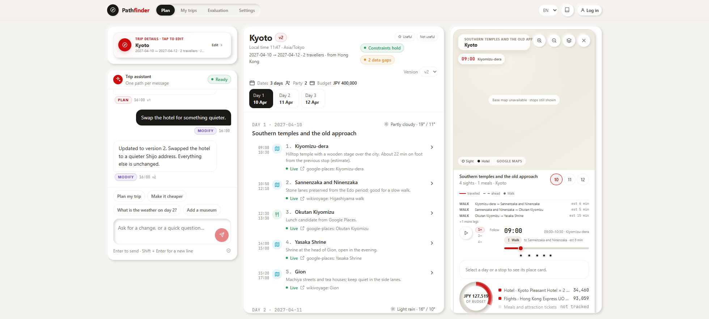

# Storybook Pathfinder

`storybook pathfinder` is the design system for this product. It was built **before** the
application screens and is the only source of presentation decisions. The app imports
its components; it does not restyle them per page.

- Source: `frontend/src/design-system/`
- Run: `cd frontend && npm run storybook` → <http://localhost:6006>
- Static build: `npm run build-storybook` → `frontend/storybook-static`



## 1. Identity

An agentic trip planner should feel like a **well-made paper travel journal with a live
instrument panel**: warm paper, white cards, a red decision accent, soft neumorphic
depth, and one calm type scale. The console is dense but never noisy; the itinerary is
the hero; sources and freshness are always legible.

- **Warm paper** `#F4F2EE` layout, white containers.
- **Decision red** `#CC0D0D` for action, intent and brand. It is scarce.
- **Ink** `#1B1915` for the dark pill, user bubbles and the hotel marker.
- **Depth** is soft-light + soft-dark, never a hard drop shadow.
- **No invented values.** Every component consumes a token alias.

## 2. Token foundation

Primitive tokens are defined in `frontend/src/design-system/tokens.css` under the
`--p30-*` namespace and wrapped in a Pathfinder semantic layer (`--pf-*`):

| Group | Count | Examples |
|---|---:|---|
| Brand | 7 | `--p30-tone-brand-primary: #CC0D0D`, secondary, muted, light, border, glow |
| Neutral | 27 | layout `#F4F2EE`, container `#FFFFFF`, body `#2B2822`, tertiary `#8F897A` |
| Feedback | 15 | success `#2A9D5C`, warning `#E08E2B`, danger `#D93A49`, info `#0099CC`, busy `#7048C4` |
| Type | 22 | heading 38/30/24/20/16/14, body 20/16/14/12/10, mono stack |
| Space | 8 | 2 / 4 / 8 / 16 / 24 / 32 / 48 / 64 |
| Radius | 8 | 4 / 8 / 12 / 16 / 20 / pill / circle |
| Shadow | 10 | neumorphic raised / pressed / inset / glow |
| Motion | 10 | 0.1–0.8 s, four easings |
| Opacity | 8 | disabled .5, secondary .65, subtle .15 |
| Breakpoints | 6 | 360 / 576 / 768 / 992 / 1200 / 1600 |
| Layout | 5 | content 1400, header 56, sidebar 240 / 272 / 72 |

Semantic aliases: `--pf-bg`, `--pf-surface`, `--pf-ink`, `--pf-line`, `--pf-accent`,
`--pf-route`, `--pf-attraction`, `--pf-hotel`, `--pf-meal`, `--pf-transit`,
`--pf-ticket`, `--pf-ok/warn/bad`, `--pf-shadow-card`.

Rule: if a component needs a value the token sheet does not define, **the component is
wrong**, not the token set.

## 3. Taxonomy

| Tier | What it means | Inventory |
|---|---|---|
| **Foundations** | Tokens, type, spacing, depth, motion | token showcase |
| **Atoms** | One job, no product knowledge | Button, IconButton, Input, Textarea, Select, Checkbox, Switch, Badge, Spinner, Avatar, Heading, Text, Divider, Slider, Dialog, Drawer, Icon |
| **Elements** | Small semantic presets | StatusPill (`ok/stale/unavailable`), IntentBadge (`plan/modify/ask/clarify`), AgentChip (running/ok/partial/unavailable), SourceLink, EmptyState, Delta |
| **Molecules** | Product-aware units | Field, SearchField, ChatBubble, TripContextForm, ClarifyCard, DayStrip, ItineraryItem, DaySection, AgentActivity, BudgetPanel, PlaceCard, MetricCard, ExperimentTable, TrendChart, GapList, ConstraintList |
| **Organisms** | Screen regions | AppHeader, TripPanel, ChatPanel, TripWorkspace, MapPanel, SavedTripsView, EvalDashboard, SettingsView, TraceList |
| **Templates** | Page skeletons | PlannerTemplate, PageTemplate |

Story titles follow `Foundations / Atoms / Elements / Molecules / Organisms / Templates`,
so a developer can navigate the whole system from one sidebar.

## 4. How the app follows it

```
App.tsx
  AppHeader
  PlannerTemplate
    TripPanel        (molecule + atoms)
    ChatPanel        (organism)
    TripWorkspace    (organism + DaySection + BudgetPanel)
    MapPanel         (organism + PlaceCard + BudgetPanel)
  SavedPage / EvaluationPage / SettingsPage  (organisms)
```

- No page writes a bespoke card, badge, button or spacing rule.
- The three-column grid, card, chat, itinerary row and map are all tokens + DS classes.
- The app-specific CSS (`src/app/app.css`) contains only the welcome/how-it-works panels
  that are outside the reusable system; every value there is still a token.
- `EvalDashboard` and `SavedTripsView` exist in Storybook, so operations screens are
  designed with the same language rather than bolted on.

## 5. Component behaviour

### Itinerary item
- 46 px time column, type icon, name + two-line note, status + source + price.
- `data-status="unavailable"` dims and strikes the name; the source pill still opens.
- Selecting sets `data-selected` (brand wash + border) and scopes the next chat message.
- Keyboard: the row is a `button` role with Enter/Space.

### Chat bubble
- User: ink bubble, right aligned; assistant: white bubble with a light border.
- Intent badge and time sit under the bubble, not inside it.

### Clarification
- A brand-edged card with inline fields and option chips. It never looks like a normal
  assistant message. Continue composes a factual message; the plan is untouched.

### Trip details
- Collapsed to one 66 px bar: destination, dates, party and budget, with `Edit`. It opens a
  right-side drawer containing the same form; generating or saving closes the drawer.
- The assistant owns the rest of the left column (`flex: 1`), so the default workspace is
  conversation-first. The form is optional, not a gate.
- The bar is a real button with `aria-expanded`; the drawer traps focus and closes on Esc.

### Map
- Google Maps is the single base map. Pins, route styling and the paper vignette are
  app-owned overlays, so the base never dictates the visual language.
- Numbered sight pins (30 px), an offset dark `H` hotel marker, and a dashed route between
  the day's verified sights. Meals stay in the itinerary rather than crowding the map.
- A **time-of-day scrubber** (06:00–23:00) with 15-minute steps, a play/pause button that
  advances ten minutes every 550 ms, and clickable stop ticks. The clock HUD shows the
  current item and its real `start–end`; pins behind the clock dim, visited stops keep the
  solid route, and the traveller token moves between stops.
- **Traveller token.** A 36 px disc carries a white mode glyph and mode colour: walk
  (stone), metro (blue), drive (rust), flight (amber). It moves along the leg with a CSS
  transform transition, pulses while travelling, and changes glyph at a mode boundary.
  The mode chip under the clock spells out `Walk · to X · est 21 min`.
- Route legs are coloured by the estimated mode: travelled legs are solid, future legs
  are dashed. Mode is a distance estimate from verified coordinates, not live routing.
- Day chips, zoom, route toggle and clear-selection controls.
- A glass place badge (day title + destination), clock pill, legend and attribution;
  the place card and budget sit under the canvas so the panel works at 390 px.
- The map playback token is interpolated between the previous and next stop with
  `requestAnimationFrame`; it moves during the gap instead of teleporting when the next
  item starts. Speed is `1× / 2× / 4×`, and the token's mode glyph changes with the leg.
- The map card uses the same 20 px card radius, border and shadow as the chat and
  workspace cards, so the third column is a card like the other two rather than a square.
- On desktop the whole right column (map, budget, trending) is independently scrollable;
  the map canvas shrinks with `clamp(340px, 44vh, 460px)` instead of being clipped.
- If the base tiles fail, a “Base map unavailable” notice appears and the pins/route still
  render on the paper background.

### Account and useful feedback
- Header shows **Log in** for guests. A signed-in account shows an avatar/name **menu
  trigger**; clicking the avatar/name opens **My trips**, **Settings** and **Log out**.
  Logging out is never the trigger's direct action.
- The dialog has login/register modes and keeps guest planning available.
- Settings shows an **Account** badge and account-memory copy when signed in, rather than
  the anonymous-browser copy.
- **Useful / Not useful** sit at the **top-right of the middle itinerary card**. Useful
  opens a 1–5 star picker; choosing a star saves, turns the control green and runs the
  saved-pop animation. Not useful becomes “Marked as not useful”.
- A green **Marked as useful** tick replaces the buttons after saving. New derived
  preference tags are announced inline. Reduced-motion users get the colour/check state
  without the pulse.

### Multiple open trips
- A tab strip above the centre card lists open sessions (`1 Hong Kong`, `2 Untitled trip`).
  Switching loads that session without regenerating it; **New trip** adds another tab.
  Trending → Try this trip creates a new tab instead of overwriting the current plan.
- Tabs are stored in `pathfinder.trips`; the active pointer stays in
  `pathfinder.session`. The trash tab button scraps only the active plan.

### Local guide citations
- `GuideNotes` is a separate soft-context card in the right column. Each note has a section,
  a sentence, an external source link, a `last_verified` date and a licence line. Notes
  older than a year show **Guide may be outdated**. The corpus version is returned by the
  API, so a screenshot or answer can be tied to a specific guide release.
- The right-column frame scrolls independently; guide notes do not make the map jump.

### Chat, profile and map playback
- The chat header has one destructive icon button, **Clear chat**, which confirms and
  removes messages only. The plan, versions and saved memory remain.
- Settings exposes a **traveller profile** (anonymous for a guest, the account's when signed
  in) with remembered preferences, chat count, useful-trip count and recent destinations. **Clear memory** removes saved trips
  and preferences, not the current itinerary.
- Map playback uses a segmented `1× / 2× / 4×` control. The token is interpolated with
  `requestAnimationFrame` between stops; it does not teleport at item boundaries.

### Budget and FX
- The budget donut stays the primary figure; below it an **FX monitor** shows the live or
  static source, the rate date, and the known total converted into a selectable display
  currency (`HKD 1,810 ≈ USD 231`). The select is the conversion control, not a second
  budget input.
- The trip form has one **Budget** row: amount input + currency select (default **HKD**).
- Every converted figure is reference data; the note says card/cash rates may differ.
- **Preferences are tags**, not comma text: Enter/comma adds a chip, the chip's × removes
  it, and Backspace removes the last chip. The same editor appears in the trip form and the
  Settings profile.

### Column layout
- On desktop all three columns share the same calculated viewport height
  (`100vh − header − planner padding`), so their bottoms align even when the right column
  has less content. The centre card and chat stretch to that height.
- The right column is a **single rounded frame** with its own scrollbar; it has a fixed
  height rather than only `max-height`, so the bottom corners are always visible and its
  contents scroll instead of stretching the page.
- The right frame uses the same 20 px radius/border/shadow language as the other cards.

### Trending rail
- A compact card rail under the map: destination, number of plans, days/year, sight chips,
  and a two-step **Try this trip** confirmation. A details disclosure explains the ranking.
- It shows only anonymous aggregate fields. Clicking `Start planning` sends the suggested
  prompt into the assistant; the current plan is untouched until the send.
- Empty, loading and error states are all first-class; a refresh icon re-runs the query.

### Evaluation
- Metric cards with baseline + delta; comparison table; trend; dataset split; failure
  drill-down in a drawer; export button. Empty state invites the first run.

## 6. Accessibility

- Every interactive element is a real `button`, `input`, `select` or `textarea`.
- The focus ring is a 2 px info-blue outline with 2 px offset, visible on paper and white.
- Icon-only controls always carry `aria-label` and `title`.
- Tabs use `role="tablist"` / `role="tab"` / `aria-selected`; day strip does the same.
- Dialogs are labelled, close on Escape, and lock background scroll.
- Colour is never the only signal: status pills pair a dot with text; deltas pair sign,
  colour and value.
- The storybook addon-a11y is enabled for component review.

## 7. Responsive rules

| Width | Planner layout |
|---|---|
| ≥ 1280 px | 360 px input/chat · flexible workspace · 420 px map/budget/trending; the right column is sticky with its own scroll |
| 900–1279 px | 380 px input/chat · workspace + map stacked on the right |
| < 900 px | one column: input, chat, workspace, map; tabs on their own row |
| 390 px | no horizontal scroll; itinerary rows collapse to time/icon/main |

The Storybook viewport presets are Phone 390, Tablet 900 and Desktop 1440.

## 8. Workflow for a new component

1. Add the token usage first. If a new value is needed, argue it at the token layer.
2. Build the smallest component that owns the job; put it in the correct tier.
3. Write a story with: playground, variant/state matrix, and one real product context.
4. Run `npm run storybook`; check a11y, phone and desktop viewports.
5. Only then import it in `app/`. No visual change should originate in a page.

Screenshots: `docs/screenshots/sb_*.png`.
