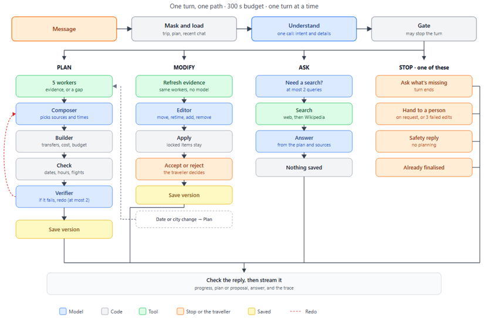

# Architecture diagram

## One turn, one path

The diagram shows the whole turn as one bounded path:

- a **message** enters the turn orchestrator with the current trip, plan and history;
- the **analyst** reads intent and details;
- the turn branches into **plan**, **modify**, **ask** or **stop**;
- a **plan** gathers evidence, composes, builds, checks and verifies before saving
  a version;
- a **modify** refreshes evidence, runs the editor, applies locked-item rules and
  asks the traveller to accept or reject a proposal;
- an **ask** answers from the plan and sources;
- a **stop** asks for missing details, hands to a person, or returns a safe reply;
- every branch ends by checking the reply and streaming progress, plan, proposal,
  answer, then the trace.

The legend: blue = model, grey = code, green = tool, orange = stop/traveller,
yellow = saved state, dashed = redo.

The technical companion is [../ARCHITECTURE.md](../ARCHITECTURE.md). The image is
`docs/architecture/pathfinder-v5-one-turn.png`; no separate diagram-generation
runtime is required to read or rebuild the submission.
