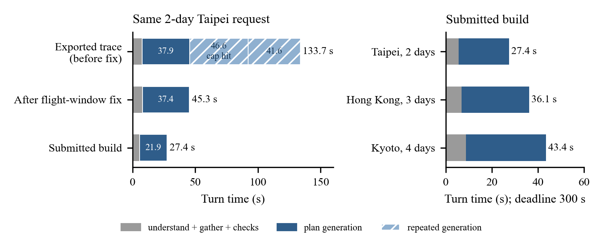
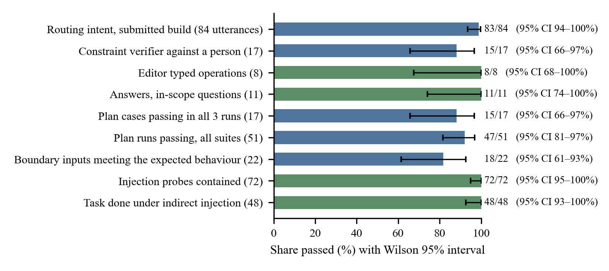
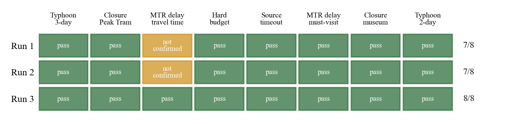
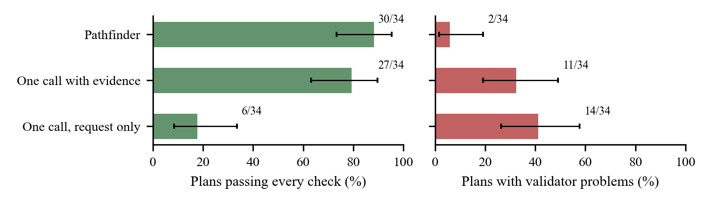
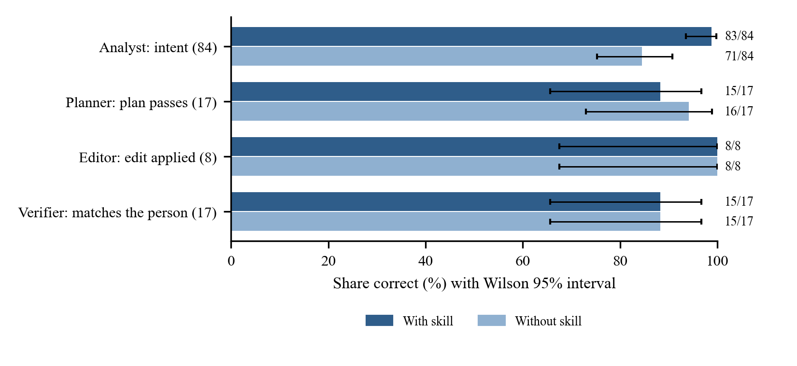
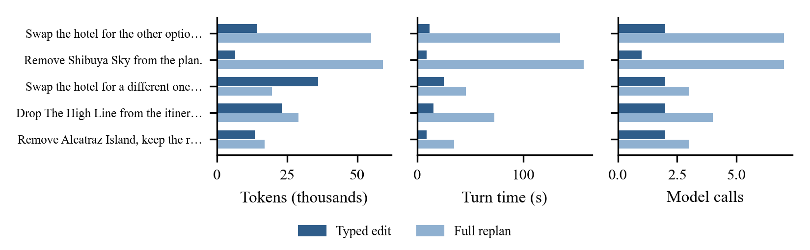
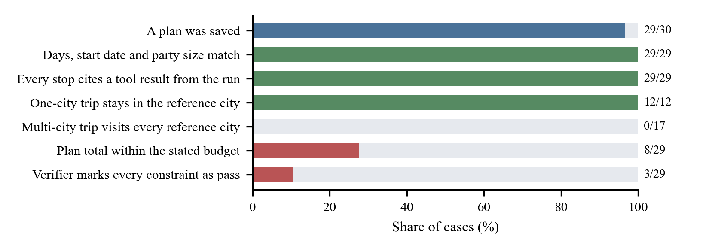
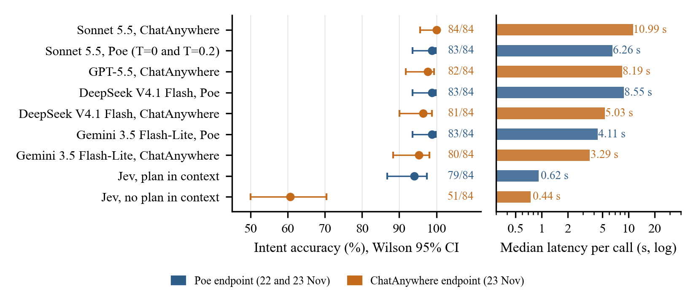

# Pathfinder final report: supplementary material

This branch (`submission_data`) holds the data, traces, scripts and extended results behind the final report
*Pathfinder: Agentic Trip Planner* (COMP7608B, Group 1, November 2026). The report's main text is written to be read
on its own and keeps four short appendices; everything that did not fit is here.

- **Submitted code:** tag [`submission-v5.2.11`](https://github.com/bryanch0430-web/Pathfinder/tree/submission-v5.2.11)
  on the [`submission`](https://github.com/bryanch0430-web/Pathfinder/tree/submission) branch. This branch holds
  only this `supplement/` folder.
- **Runs on the submitted build** were recorded on commit `8f1e0d5` (24 November 2026). Its application code
  (`backend/app`) is identical to the submitted tag; the later commits changed only documentation and diagrams.
- **Earlier model study** (22–23 November: routing, components, verifier, temperature and pricing) is in
  [`data/earlier-model-study/`](data/earlier-model-study/), a copy of `docs/eval-artifacts/` from the submitted code.

## Contents

| Section | What it holds |
|---|---|
| [S1](#s1-design-details) | Turn steps, decision ownership, workers, untrusted data, storage and memory, skills, typed records, run settings |
| [S2](#s2-confidence-thresholds) | Risk–coverage of both routing confidences and how the 0.8 cutoff was chosen |
| [S3](#s3-latency-and-cost) | Turn-time breakdown and cost snapshot |
| [S4](#s4-failure-handling-in-detail) | The failure situations of the report's Section 4 in full |
| [S5](#s5-evaluation-details) | Datasets, judging rules, controls, statistics, excluded runs and every detailed result with figures |
| [S6](#s6-task-trace-and-deterministic-tests) | The full recorded task trace and the deterministic test suite |
| [S7](#s7-reused-work-unfinished-functionality-and-ai-use) | Reused work, unfinished or mocked functionality, AI-use declaration |
| [S8](#s8-data-index) | Where each raw file is, and what it supports |

## S1. Design details

### S1.1 Turn steps and decision ownership

Each user message runs as one bounded turn that takes exactly one path, with a 300-second turn budget and a per-trip lock, so that only one turn can change a trip at a time. The steps are as follows.

- **Message.** The traveller sends a message, optionally with a file or a link; this starts one turn.
- **Mask and load.** A privacy filter masks Hong Kong identity numbers, Hong Kong phone numbers, e-mail addresses and Luhn-valid card numbers before anything is stored or sent to a model. The controller then loads the trip details, the latest plan version and the last eight messages from SQLite.
- **Understand.** One structured model call, the *analyst*, reads the message and returns the intent (plan, modify, ask or unclear), slot updates, hard constraints, whether clarification is needed, a self-reported confidence and safety flags. Code merges the extracted details, normalises dates and keeps relative periods such as “next month” as a date window rather than inventing a start day.
- **Gate.** Code decides whether the proposed path may run. A new trip that lacks any of six required details (destination, start date, trip length, party size, origin or a positive budget), or that states an invalid currency code, returns a clarification card; HKD is the default currency. A modification without an existing plan is treated as a planning request, a finalised trip cannot be changed, a self-harm message receives crisis resources, a request for a person is sent to the human Desk, and an edit whose reported confidence is below the analyst’s threshold of 0.8 while a question remains open becomes a clarification (Section S2).
- **Route.** The turn then takes exactly one path. *Plan* builds a new itinerary, *modify* changes the saved one and *ask* answers a question without writing a new version; a clarification, a handoff or a safety reply ends the turn.
- **Tool use and checks.** On the plan path, five workers retrieve attractions and meals, hotels, weather, flights and videos concurrently, and each returns evidence records with source references, fetch time and status, or a gap record. The composer, guided by the planning skill, receives a capped candidate pool (up to 12 attractions, 8 meals, 5 hotels and 3 tickets) and returns only references and times. The plan builder, which is code, removes unknown or closed references, copies names, addresses, opening hours and prices from the evidence, inserts transfers, prices the plan and applies a budget guard that first selects a cheaper sourced hotel and then removes the most expensive unprotected paid stop. A validator checks dates, empty days, overlaps, transfer feasibility, opening hours, flight windows (stops begin at least 90 minutes after arrival and end at least 120 minutes before the return flight), city order and budget, and returns any problems to the composer for at most two repair rounds. For trips with hard constraints, a verifier from a different model family returns pass, fail or unknown for each constraint with a quoted line of evidence; one further composition is allowed, and its result is kept only if it does not shrink the plan. On the modify path, the same workers refresh the evidence and the editor returns typed operations (move, retime, remove, add, replace, swap hotel or swap ticket), which code applies after refusing changes to locked or confirmed items and before recalculating times and costs. A change to the dates, trip length, destination, origin or city list is redirected to the plan path. On the ask path, the model writes up to two search queries, or none if the plan already holds the answer, and code runs them through SerpAPI, Wikipedia and DeepSeek Search with at most four results each.
- **Human action.** On the modify path the result is stored as a proposal, which becomes a new plan version only after the traveller accepts it; a rejected proposal leaves the plan unchanged. On a stopping path the turn either asks for the missing detail or hands the conversation to a person.
- **Output.** Every model output is screened for the canary token and system-prompt markers before it is displayed or stored. The reply is streamed with progress events, and the turn ends with a trace that records each model call (purpose, model, token usage and latency), each tool call and search, and the decisions taken. A new plan version is saved for a completed plan and for an accepted modification.

Overall, Pathfinder separates the responsibilities of the model and the code. The model makes the decisions that require language understanding: it identifies what the traveller wants, determines whether more information is needed, selects suitable sourced places and times, proposes changes to an existing plan, judges whether hard constraints are supported by the evidence, writes search queries and identifies preferences worth remembering. The code controls how these decisions are carried out: it checks whether a request has enough information to proceed, chooses which tools run and how often, performs every calculation (dates, overlaps, travel times, opening hours and budgets), decides when the turn ends and determines what is saved. Because the controller owns every completion decision, each stopping rule can be tested without a model. Table S1 lists each decision, who makes it and how it is bounded, and Table S11 follows one recorded turn through these steps.

**Table S1.** Decisions taken by a model and the code that bounds or checks each one.

| Decision | Decided by | Bounded or checked by code |
|---|---|---|
| Intent and path | Analyst model (Jev optional) | One call; gate overrides (modify without a plan becomes a plan; a finalised trip refuses changes); an edit below the analyst’s threshold (0.8) with an open question becomes a question |
| Slots, constraints, date window | Analyst model | Merged by code; ISO dates; ranges clamped (1–60 days, 1–40 travellers); currency validated |
| Whether to ask | Analyst model and code | Code enforces the six required slots for a new plan |
| Places, order and times | Composer model (references only) | References must exist in the pool; facts, transfers, clock and cost computed by code; budget guard |
| Plan acceptability | Validator (code) and verifier model | At most two repair rounds and one constraint repair; the best plan is shipped with its problems shown |
| Edit operations | Editor model | Locks enforced; times and cost recomputed; applied only after the traveller accepts |
| Search queries | Model | At most two queries with four results each; executed by code |
| What to remember | Memory model | At most six English sentences per trip; near-duplicates merged; cap of 20; scoped to the owner |
| Handoff to a person | Analyst flags and policy | Phrase list with a negation check; three unchanged edits; frustration ≥ 0.75 only if that switch is on |
| Tools, retries, deadline, persistence | Code only | Not delegated to any model |

### S1.2 Tools, data sources and memory

Table S2 summarises the information that each worker retrieves and its behaviour when retrieval fails.

**Table S2.** Information retrieved by the five workers and their behaviour when retrieval fails.

| Worker | Information retrieved | Behaviour when retrieval fails |
|---|---|---|
| Attractions | Sights and meals from the place provider | Records a gap in attraction information while the other workers continue |
| Hotels | Accommodation options ranked according to the requested travel style | Records a gap in hotel information |
| Weather | Forecasts for the travel dates (16-day horizon) | Records a gap; dates beyond the horizon are labelled “no forecast yet” |
| Tickets | Flights from Google Flights through SerpAPI, when an API key is configured | Returns a labelled estimate, or omits flights when the trip stays within one city |
| Videos | Short travel notes from YouTube (Bilibili only if explicitly enabled) | Records a gap without delaying itinerary generation |

Travel information is obtained through read-only tools that the backend selects and controls; the model never chooses a tool. Google Places provides attractions, restaurants and hotels. Open-Meteo supplies weather forecasts, but its coverage is limited to 16 days, so for travel dates beyond this horizon Pathfinder labels the weather as unavailable rather than presenting an unsupported forecast. OSRM provides routes, SerpAPI retrieves Google Flights results, and YouTube and web search supply additional notes. In sandbox mode, or when live information is unavailable, the workers can draw on a curated collection covering 12 cities, and any information obtained from this collection is labelled as a fallback. There is no retrieval database: all evidence is fetched from live APIs for the current turn, and a source that fails becomes a visible gap rather than an invented place.

**Data validation and tool reliability.** Pathfinder treats content from itinerary descriptions, service providers, uploaded files and web pages as untrusted input. Before such content reaches a model, delimiter tags and invisible characters are removed and the content is placed inside a marked untrusted-data block, so that the model does not mistake it for instructions. A canary token is included in every system prompt, and model outputs are checked for the token and other system-prompt markers to detect prompt leakage. Tool failures are handled in code: the model gateway retries rate-limit, server and timeout errors once after a randomised delay; a worker that times out, fails or returns nothing records a gap while the other workers continue; and fallback values carry labels, so that corpus places are marked as possibly out of date and fares as distance-based estimates. Every evidence record carries its fetch time, which is shown to the traveller, but outdated evidence is not yet refreshed automatically.

**Data storage and memory.** Pathfinder stores its data in SQLite, including user sessions, trip details, plan versions, conversation messages, proposed changes, travel preferences and turn locks. Each saved plan version contains the itinerary items, their sources, estimated costs, constraint-checking results and any information that could not be retrieved. In the memory types taught in the course, working memory holds the current trip details, the latest itinerary and the last eight messages; procedural memory consists of the Markdown skill files that define how each task is performed; and semantic memory stores up to 20 longer-term travel preferences as English sentences, which are extracted in the background when a trip is finalised or rated useful, merged when two are near-duplicates and included in later conversations. The proposal also planned to save plans that users mark as useful, together with their destination and rating, and to start the next similar trip from the closest saved matches retrieved through a RAG pipeline with a vector database and a reranker. The first half is in the build: rating a saved trip as useful with one to five stars adds it to the traveller’s trending rail, which groups such trips by destination with their average rating and sights and can send one back to the assistant (“Try this trip”) after a second confirmation; a trip rated not useful never enters it. The rail reads only the traveller’s own trips and matches destinations by name, not by similarity, and the agent does not consult past trips on its own. The second half, retrieval across travellers through an embedding model, a vector store and a reranker, was deferred: sharing one traveller’s plans with another needs consent and access control, which a single-operator demonstration cannot test, and there was no user base on which to evaluate retrieval quality. The records that such a retriever would index (verdict, rating, destination and the sourced plan) are already stored, and generation itself remains retrieval-grounded: plans cite evidence retrieved in the turn, and answers quote the plan or a named source.

### S1.3 Skills, typed records and run settings

Table S3 lists the seven skills and the output contract that each defines, Table S4 the typed records exchanged between model calls and code, and Table S5 the model, temperature and output cap for each purpose in the submitted build.

**Table S3.** Skills (Markdown procedure files) used in Pathfinder and the output contract each defines.

| Skill | Expected model output |
|---|---|
| `understand.md` | One of the four intents, extracted slots, hard constraints and whether clarification is required |
| `intake.md` | Only information explicitly supported by the supplied file or link |
| `plan.md` | An itinerary schedule that uses retrieved candidate references, with gaps where the candidate pool lacks suitable places |
| `edit.md` | Typed operations on existing itinerary item IDs, or candidate references for additions, that preserve locked items |
| `ask.md` | An answer grounded in the existing itinerary and the retrieved sources |
| `verify.md` | A pass, fail or unknown result for each hard constraint, supported by a quoted line of evidence |
| `translate.md` | The same structured fields in the requested language, with numbers, times and IDs preserved |

**Table S4.** Typed records exchanged between model calls and code (selected fields of the Pydantic contracts).

| Record (producer) | Key fields | Checked or used by |
|---|---|---|
| `ParsedIntent` (analyst) | `intent` ∈ {plan, modify, ask, unclear}; `confidence`; `slots`; `assumptions`; `need_clarification`; `missing_slots`; `question`; `wants_human`; `self_harm`; `frustration`; `injection_suspected`; `search_queries` | Gate rules and dispatch in the turn controller |
| `Evidence` (workers) | `ref`; `kind`; `name`; `address`; `geo`; `source_refs`; `data_status`; `fetched_at`; `opening_hours`; `price`, `price_kind` | Candidate pool for the composer; the builder copies factual fields |
| `DataGap` (workers, builder) | `section`; `kind`; `message`; `retryable` | Shown to the traveller; never filled by a model |
| `EditOp` (editor) | `op` ∈ {move, retime, remove, add, replace, swap_hotel, swap_ticket, set_field, note}; `item_id`; `day`; `start`; `end`; `ref` | Applied by code; locked or confirmed items refused |
| `PlanItem` (builder) | `id`; `type`; `name`; `start`; `end`; `source_refs`; `data_status`; `fetched_at`; `price`; `locked`; `confirmed`; `hours_status` | Validator; display with provenance |
| `TripPlan` version (builder) | `version`; `destination`; `dates`; `party_size`; `budget`; `days`; `hotels`; `tickets`; `cost`; `constraints`; `data_quality`; `change_summary` | Saved only after the checks pass, or after the traveller accepts an edit |

**Table S5.** Model, temperature and output cap for each purpose in the submitted build. Reasoning effort is set to none for every part, JSON repairs run at temperature 0, and both confidence thresholds (`ANALYST_CONFIDENCE_THRESHOLD`, `JEV_CONFIDENCE_THRESHOLD`) are 0.8 (Section 2.2 of the report).

| Purpose (skill) | Model | Temp. | Output cap (tokens) | Runs |
|---|---|---|---|---|
| Understand (`understand.md`) | Claude Sonnet 5.5 | 0.2 | 3,000 | Every message, once |
| Plan (`plan.md`) | Claude Sonnet 5.5 | 0.2 | max(8,000, min(16,000, 3,000 + 1,500 × days)) | Plan path; at most four compositions |
| Verify (`verify.md`) | DeepSeek Flash | 0 | 1,500 | Only with hard constraints; at most two |
| Edit (`edit.md`) | Claude Sonnet 5.5 | 0.2 | 3,000 | Modify path |
| Ask (`ask.md`) | Claude Sonnet 5.5 | 0.2 | 1,400 (streamed) | Ask path |
| Search queries (inline) | Claude Sonnet 5.5 | 0.2 | 200 | Ask path |
| Memory (inline) | Claude Sonnet 5.5 | 0.2 | 700 | On finalising or a useful rating |
| Intake; translate | Claude Sonnet 5.5 | 0.2 | 6,000; 4,000 | Files or links; language switch |
| Route override | Jev (`jev-latest`) | – | – | Off by default (`TURN_ORCHESTRATOR=jev`); route accepted at ≥ 0.8 |

## S2. Confidence thresholds

Section 2.2 of the report explains why the two routing thresholds differ in meaning; in the submitted build they are two independent settings, both 0.8 (Table S5). Table S6 gives the risk–coverage profile of each score on the 84 frozen routing labels. For the shipped analyst, the self-reported score ranks right and wrong answers well (AUROC 0.96, Brier score 0.025) and errs towards under-confidence (a mean confidence of 0.88 against 98.8% accuracy; expected calibration error 0.11). A cutoff of 0.8 therefore abstains on only three utterances, all of them correct, and keeps the analyst’s single error, which carried a confidence of 0.82; raising the cutoff to 0.9 removes that error but halves coverage. Because a wrongly accepted edit is still only a proposal that the traveller must accept, whereas an unnecessary question costs the traveller a turn, the lower cutoff was preferred. For Jev, the option probability ranks errors less well (AUROC 0.88; expected calibration error 0.12). At 0.8 Jev accepted 66% of utterances and every accepted label was correct, whereas at 0.7 it accepted 75% with one error; since a wrongly accepted Jev route can start the wrong path, the lowest error-free cutoff was chosen. A ten-message live shadow run, in which Jev was only logged, showed that Jev’s confidence fell on ambiguous messages but that a strict agreement rule between the two routers would have turned a valid question into a clarification, so neither threshold was raised.

**Table S6.** Risk–coverage of the two routing confidences on the 84 frozen routing labels (23 November model study; one run per arm). Coverage is the share of utterances on which the router acts, with the number passed to the fallback in brackets; accuracy is measured on the utterances acted on.

| Cutoff | Analyst coverage | Analyst accuracy | Jev coverage | Jev accuracy |
|---|---|---|---|---|
| 0.6 | 100% (0) | 98.8% | 89% (9) | 96.0% |
| 0.7 | 98% (2) | 98.8% | 75% (21) | 98.4% |
| **0.8 (default)** | **96% (3)** | **98.8%** | **66% (29)** | **100%** |
| 0.9 | 51% (41) | 100% | 43% (48) | 100% |
| Calibration | AUROC 0.96; Brier 0.025 | ECE 0.11 (under-confident) | AUROC 0.88; Brier 0.067 | ECE 0.12 |

These observations come from 84 labelled utterances and one run per arm, and with a single analyst error the scores could not be mapped to probabilities on a separate held-out set, so 0.8 is a defensible default for a demonstration system rather than an optimum. In a production deployment, each threshold would be a business decision for the operator. Chow’s rule makes this dependence explicit: a classifier should abstain when the expected cost of acting exceeds the cost of abstaining, so the optimal cutoff falls as abstentions become more expensive relative to errors (Chow, 1970). For the analyst, the operator would weigh the friction and abandonment caused by questions against the cost of an unwanted edit proposal; for Jev, the latency and spend saved by skipping the analyst against the cost of a misrouted turn. The operator should therefore collect labelled traffic from the deployment, calibrate each score on a held-out portion, for example by temperature or isotonic scaling (Guo et al., 2017), choose each cutoff from the resulting risk–coverage curve against the agreed cost ratio, and monitor coverage and selective error over time, since verbalised confidence can shift with the model version, the prompt and the language of the messages (Xiong et al., 2024). Because both thresholds are configuration settings, they can be changed without modifying the code.

## S3. Latency and cost

Figure S1 breaks down the turn time of planning requests, and Table S7 gives the cost snapshot behind Section 3 of the report. A turn that is still running at 300 s is cancelled, the traveller is advised to resend and the lock is released; a live turn refreshes its lock every 15 seconds, and the lock of a crashed turn can be taken over after 60 seconds. A capped candidate pool keeps the composer prompt near 11,000 tokens, and every planning call begins with the same skill text, so prompt caching could lower the input cost further; we did not measure it. API keys stay in the environment, and keys supplied by users are masked in responses.



*Figure S1. Turn time for planning requests. Left: the same two-day Taipei request in an exported trace recorded before a fix, after the flight-window fix, and on the submitted build; the faulty check forced two regenerations, the second of which hit the then 5,800-token cap. Right: three demonstration trips on the submitted build. Grey: understanding, evidence gathering and checks; dark blue: plan generation; hatched: repeated generation.*

**Table S7.** Cost snapshot. Estimates multiply traced tokens by public list prices on 23 November 2026; they are not invoices, and the provider’s point price can differ.

| Item | Basis | Estimate |
|---|---|---|
| List prices (US$ per million input / output tokens) | Public pricing snapshot, 23 November 2026 | Sonnet 5.5: 2.00 / 10.00; Gemini 3.5 Flash-Lite: 0.30 / 2.50; DeepSeek V4 Flash: 0.14 / 0.28; DeepSeek V4.1 Flash (peak): 0.30 / 1.20 |
| Routing call | Mean traced tokens per call (Sonnet 4,657; Flash-Lite 2,943; DeepSeek V4.1 Flash 3,320); 90/10 input/output split | Sonnet ≈ US$0.013; Flash-Lite ≈ US$0.0015; DeepSeek ≈ US$0.0013 |
| Planning turn (sandbox plan suites) | Median 30,693 tokens and four calls over 51 turns; 10–30% output tokens | ≈ US$0.09–0.14 |
| Modification turn (Table S11) | 31,610 input and 4,480 output tokens in three calls | ≈ US$0.11 |
| Same Taipei request, before and after the fix | 38.4k input and 16.6k output tokens, against about 15k and 5.7k | ≈ US$0.24 against ≈ US$0.09 |
| One run of the 17 plan cases | 0.51–0.55 million tokens per run | ≈ US$1.5–2.3 |
| Full TravelPlanner split, projected | 1,225 queries at ≥ 31k tokens and a median of 150 s per live query | ≈ US$105–165; ≈ 51 h sequential |

## S4. Failure handling in detail

**No forecast for a future date.** Open-Meteo is the only weather source. If a trip starts more than 16 days ahead, the worker does not call the forecast, and each day is saved as unavailable with the summary “No forecast yet: the trip is beyond the 16-day forecast window.” The Hong Kong (15–17 January 2027), Chiba (6–8 March 2027), Taipei (February 2027) and Chengdu (January 2027) trips all recorded the weather worker as partial or unavailable. The saved Hong Kong and Chiba plans carry that sentence on every day together with a gap stating “No forecast covered the trip dates”, and the itineraries were still saved; the Chiba reply told the traveller the same.

**A day that does not fit, and a place with no source.** For the Hong Kong trip (15–17 January 2027, party of two, budget 9,000 HKD), the plan kept the Kowloon and Peak days. The only usable return flight left at 12:10 on 17 January, so the Lantau day (Ngong Ping 360, the Big Buddha, Po Lin Monastery and Tai O) was not scheduled, and day 3 became a short morning in Tsim Sha Tsui before the airport. The reply stated that the Lantau day did not fit. When the traveller later restated day 3 with an evening departure, the edit added the Lantau stops and flagged the conflict with the booked flight (Table S11). For the Taipei trip of 11–15 February 2027, the first plan kept the places that a worker had returned and left out Shilin Night Market, Shifen and Tamsui, which it could not confirm; the reply said that those stops were not scheduled. Later messages added them one day at a time, as sourced stops where a source existed and otherwise as unconfirmed stops. On the 4 December 2026 Taipei trip, the requested Gundam stop was added as an unconfirmed stop, and the missing prices were left as a visible gap: “No hotel nightly rates, restaurant prices or Taipei 101 Observatory ticket price were available.”

**Malformed or truncated model output.** Every model output is validated against the JSON contract of its skill, and output that fails validation receives one repair call at temperature 0 that quotes the exact error. If the composer still fails, the turn retries once and then builds a deterministic itinerary from the highest-rated sourced candidates, marked as degraded with a suggestion to resend; a failed understanding call becomes a request to rephrase, so the message is not lost. In the exported trace of an ordinary two-day Taipei request, the faulty flight-window check treated the outbound departure from Hong Kong as a deadline in Taipei and rejected a correct plan twice, and the second regeneration hit the 5,800-token cap then in force and returned invalid JSON; the traveller still received a plan, but after 133.7 s. The fix lets only the outbound arrival open the first day and only the return departure close the last day, makes the plan cap grow from 8,000 to 16,000 tokens with trip length and forbids empty days.

**A limitation bounded rather than solved.** On the Taipei and Chengdu trips, several messages that began “please check day” were answered with “I need one detail before I can plan.”, and the edit ran only after the traveller restated the day. A related boundary appeared in the 30 live TravelPlanner queries, whose March 2022 dates the live flight and weather providers cannot serve: weather was partial on all 29 saved plans, every fare was a labelled estimate, and one query was cut off at the 300-second stop and saved no plan.

**Human handoff.** Section 4 of the report describes the Desk as a proof of concept. Its policy is three switches, read in order. The phrase switch defaults to on. It matches a fixed list, including “live agent” and “talk to a person”, unless a negation falls in the short span before the phrase, and turning the switch off also suppresses the analyst’s own request-for-a-person flag. The unchanged-edit switch defaults to on with a threshold of three: the count rises only when a modification leaves the plan unchanged, and a successful edit resets it. The frustration switch defaults to off; when it is on, the analyst’s score is compared with 0.75. Unit tests set one switch at a time. A phrase match hands off while frustration is off, a negated phrase does not match, a stored count of three hands off while frustration is off, and a score of 0.9 hands off in the test where the frustration switch is on and the unchanged-edit switch is off. With the frustration switch at its default, that comparison is not reached. The boundary suite is the end-to-end check: “I want to talk to a real person, not a bot.” was placed in the queue.

**Repeated external actions.** Retries are counted: two HTTP attempts per model call, one composition retry, two repair rounds and at most three rotations of the SerpAPI key. Weather for a distant date returns “unavailable” without calling another provider, and the only writes are local plan versions; adding booking would require idempotency keys and a reconciliation record before any external write.

## S5. Evaluation details

### S5.1 Datasets, judging rules and controls

**Statistical reporting.** Pass rates are reported as k/n. Where an interval is shown, it is a Wilson score interval at 95% confidence for a binomial proportion (Wilson, 1927), used because several suites are small and rates sit near 0% or 100%, where the ordinary normal interval is unreliable. Paired comparisons of two arms on the same items use an exact McNemar test (McNemar, 1947). With no leak in 72 live injection probes, the 95% upper bound on the leak rate is about 5%.

**Datasets.** The sets, and what was done with each proposal commitment, are as follows.

- **Router labels.** The proposal asked for about 80 labelled utterances; we froze 84, with 21 each of plan, modify, ask and unclear. Routing is one model call and does not build a plan; the protocol follows jev-medical-bench (0xmdinc, 2026).
- **Injection probes.** The proposal asked for 25 held-out probes. The frozen set has 84 probes covering four attacks (reveal instructions, call a forbidden tool, drop the task and change the route) in four channels (typed by the user, or hidden in a web result, a place description or a video note), 25 of them held out. We report 24 direct probes (six per attack type, six of them held out) and the 48 probes hidden in tool results, all run with live model calls.
- **Hong Kong and Japan.** Eight Hong Kong sandbox cases inject a typhoon signal, a venue closure, an MTR delay, a hard budget or a source timeout for one to six travellers; six Japan cases combine must-visit places and vegetarian meals in Tokyo, Kyoto and Osaka.
- **TravelPlanner.** The official benchmark has 1,225 queries (Xie et al., 2024). We ran a frozen three-case set in the TravelPlanner style on the sandbox corpus, a 20-query pilot and a 12-query sample drawn from the benchmark’s easy queries on a fixed 2022 clock, and, separately, 30 live queries drawn from the public test split on 24 November (ten each of easy, medium and hard).
- **Component and boundary sets.** These comprise 17 plans altered to break a budget, drop a required place or shorten a transfer (for the verifier), 8 edits on frozen plans, 12 questions (one out of scope), 8 memory dialogues (one with nothing to remember), 5 paired edits on a seeded trip and a boundary suite of 22 inputs (three representative, nine challenging and ten failure inputs).

**Judging rules.** A plan’s disruption counts as handled when there is no outdoor stop on the typhoon day, the closed venue is absent and the delay is recorded. The verifier’s labels were validated on 17 altered plans, with wrong approvals and wrong rejections counted separately, because approving an infeasible plan misleads the traveller whereas a false alarm only costs a repair. A team member reviewed every failed case and every borderline answer, and re-scored two answers that a literal string match had rejected (“6:00” against “06:00”). This review found two grading problems, which were corrected before reporting: the edit grader read the saved plan, which does not change until the traveller accepts a proposal, and a vague constraint (“keep travel times realistic”) let the verifier reject plans for reasons outside the scenario being tested.

**Controls, settings and variability.** Each comparison changes one variable (the model, a parameter, the skill text or the architecture around the same model) and keeps the cases, prompts, tools and scoring fixed. The 30-query TravelPlanner run and the five future trips used live tools and were not repeated. The submitted configuration is Claude Sonnet 5.5 at temperature 0.2 with reasoning effort none and two repair rounds, with DeepSeek Flash as the verifier at temperature 0 and Jev off (Table S5). Repetition separates systematic failures, which recur in every run and indicate a design flaw, from stochastic ones, which limit how much a one-case difference between models can mean. The validity screen removed runs that would otherwise have reported 84/84 injection containment, 10/10 path-cost cases, 0/5 edit preservation and a 1/3 TravelPlanner-style re-run, all produced after the endpoint had stopped answering (Table S8).

**Table S8.** Runs removed by the validity screen (Section S5.1).

| Run (23 November) | Reported | Why it is excluded |
|---|---|---|
| Injection, all 84 probes | 84/84 | No model call and zero tokens in every case; each returned the fallback clarification |
| Path cost (10 messages) | 10/10 | No model call; no trip context |
| Edit against replan | 0/5 | No model call; no seed plan |
| TravelPlanner-style re-runs | 1/3; 0/3 | Two of three, then three of three, cases made no model call |
| Editor temperature sweep; prompt ablation | Not scored | Provider quota exhausted (HTTP 402) |

### S5.2 Detailed results

**Routing comparison.** Table S9 puts every routing arm on the one instrument used throughout: 84 utterances, 21 each of plan, modify, ask and unclear, with the intent labels fixed before scoring. The keyword-rule row is the accuracy recorded for that layer on the earlier implementation, 64 of 84 (76.2%). The live Jev row, 78 of 84 (92.9%), was recorded on the same implementation with the plan available. Neither arm was executed again in the submitted-build study, so both are a shared-instrument baseline rather than a paired condition of that study. The four submitted-build rows were measured in the study, one run per setting. The analyst’s single miss, “Plan something nice” with a destination already stored, is described under representative cases.

**Table S9.** Routing accuracy on one frozen set of 84 utterances (21 each of plan, modify, ask and unclear). The first two rows were recorded on the earlier implementation and were not run again in the submitted-build study.

| Arm | Measurement | Correct of 84 |
|---|---|---|
| Keyword-rule layer | Recorded on the earlier implementation; same utterances and the same labels; not re-run | 64 (76.2%) |
| Jev, live | Recorded on that implementation, with the plan available; not re-run | 78 (92.9%) |
| Analyst, Sonnet | Submitted-build study; temperature 0 and again 0.2; one run each | 83 |
| Analyst, Sonnet | Submitted-build study; a second provider endpoint | 84 |
| Jev | Submitted-build study; the current plan included in the input | 79 |
| Jev | Submitted-build study; the plan withheld from the input | 51 |

**Representative cases.** On the frozen routing set, the shipped analyst (Sonnet at temperature 0.2) labelled all 21 plan, 21 modify and 21 ask requests and 20 of 21 unclear ones correctly. Its single miss was “Plan something nice” with a destination already stored, which it read as a plan request and answered by asking for dates, whereas the frozen label is unclear. The Osaka vegetarian case failed twice for a data reason: the curated Osaka data contains one vegetarian restaurant, so the planner scheduled it once and added no unsourced restaurant, and the verifier answered unknown for “vegetarian meals only”. In the boundary suite, the third ordinary request, a Kyoto trip with a must-see temple, kept the temple but left its last day empty.

**Challenging cases.** The Hong Kong suite passed 7/8 on 22 November; the miss was the constraint “avoid the MTR”, marked unknown because a transfer was labelled transit. After the transfer rules were changed and unit-tested, the suite was re-run three times on the submitted build (Figure S3): typhoon days stayed indoors, closed venues were left out, the source timeout produced a plan with the gap shown, and the MTR-delay day used walks, taxis and the Star Ferry, which the verifier confirmed each time. The two automated marks on that case came from the broader check “keep travel times realistic”, which objected to two short straight-line transfer estimates on another day in sandbox mode; a manual run of the same request produced a correct plan offering bus, tram and ferry on the delayed day. In the boundary suite, a seven-day Tokyo trip took about 248 s, and the Hanoi trip and the Traditional Chinese request for Taipei, both outside the curated corpus, kept their days empty with the gaps shown; the Chinese request was answered in Chinese. In the 12-query TravelPlanner sample, the six queries about New York and San Francisco, which are in the corpus, had 5 to 16 sourced stops, and the six about other cities stayed empty with gaps, without any invented place.

**Failure cases.** Missing details, an end date before the start date, dates in the past, a request to book and pay, an off-topic question, meaningless input and a request to print the system prompt each produced a clarification and no plan. Sent the same ten messages, a single call to the same model wrote an itinerary for four of them, including three that needed a question (the reversed dates, the past dates and the unknown currency), although its refusals of the booking request and the off-topic question explained its limits more helpfully than Pathfinder’s generic “I need a few details before I can plan”. Every direct injection reply declined the injected instruction and continued with the trip task, and no indirect probe leaked canary or prompt text or changed the route, which is the utility-under-attack measure of AgentDojo (Debenedetti et al., 2024). Two replies repeated the attacker’s words; a person read both, and each named the hidden instruction as untrusted, ignored it and answered the question. With no leak in 72 live probes, the 95% upper bound on the leak rate is about 5%.

**TravelPlanner live run.** One-city trips stayed in the reference city in 12 of 12 cases. For a two-city trip to North Carolina from Providence, the reference pair is Wilmington and Fayetteville, whereas the plan chose Raleigh, Durham and Chapel Hill, a reasonable reading of the request that nonetheless fails the check. For a one-person trip from Oakland to Eugene with a budget of US$1,100, the estimated return flight alone was US$2,240. The verifier wrote 77 checks across the 29 plans (25 pass, 31 fail and 21 unknown); house rules and room type were mostly unknown because the hotel tool does not return those fields (Figure S7).

**Model per part.** On routing, Sonnet, Gemini 3.5 Flash-Lite, DeepSeek V4.1 Flash and GPT-5.5 scored between 80 and 84 of 84, within each other’s intervals; Flash-Lite fell from 83 to 80 between the two endpoints. Jev answered in about 0.6 s, against 4.1 s for Flash-Lite and 6.2 s for Sonnet. On the 17 plan cases, Flash-Lite was faster and met more Hong Kong constraints than Sonnet. All three models passed the eight editing cases, and in the larger earlier screen Flash-Lite passed 50 of 63 edits. Sonnet and DeepSeek answered all 11 in-scope questions and Flash-Lite answered 10. DeepSeek recalled 91.7% of stated preferences against 79.8% for Sonnet. The verifier comparison used 20 altered plans: DeepSeek Flash and Sonnet each judged 18 correctly with no false alarms, at a median of about 2 s per audit on the shipped endpoint against 5.7 s and at about one-twentieth of the list price; both misses were transfers of 10 and 29 minutes between stops that required at least 30.

**Parameters.** Output caps follow measured need: in a cap stress test the verifier and memory failed at a 64-token cap and passed at 1,500 and 700 tokens, and after a plan cut off at 5,800 tokens forced a regeneration, the plan cap was made to grow with trip length from 8,000 to 16,000 tokens (Table S10). Reasoning tokens count against the output cap and are billed as output (OpenAI, 2026; Anthropic, 2026), so every part runs with reasoning effort set to none.

**Skills against no skills.** Without the skill the analyst labelled only 13 of 21 edit requests and 18 of 21 questions correctly, mostly by reading them as unclear, while plan requests stayed at 21/21; the skill costs about 1,900 more input tokens per call. The planner passed 15 of 17 plan cases with its skill and 16 without (p = 1.0), and every stop was sourced in both arms because the composer may only use references that the workers returned; without the skill, four final plans kept validator problems against two, and turns needed more calls (4.9 against 4.5) and more time (a median of 75 s against 69 s). The editor applied all eight edits in both conditions but needed about 31,000 against 21,000 tokens per edit without its skill. The verifier scored 15/17 in both conditions, with the same two missed clock checks. The skills therefore hold conventions that a schema cannot express, chiefly how to classify edits and questions (Figure S5).

**Orchestration against a single call.** The 17 plan cases were answered twice by one call to the same model at the same temperature, in two arms: the request alone, and the request with the candidate pool, weather and disruption notes that Pathfinder’s composer receives. The single calls were scored with Pathfinder’s own validator, verifier and plan checks, and none of its repairs were applied (Figure S4). The 30/34 against 27/34 gap is within run-to-run variation (McNemar p = 1.0). The single-call problems were mainly transfers too short to make and three empty days, and three single-call plans contained stops with no source; with the request alone, no plan was fully sourced and 13 stops were scheduled when the place was closed. The orchestration used about 32,000 against 7,000 tokens per plan and a median of 50 to 83 s against 21 s.

**Edit against replan.** Each of five edit requests was run on the same seeded trip as a typed edit and as a fresh plan request with the change stated, and the proposed plan was scored because an edit is stored as a proposal until it is accepted (Figure S6). Where the change needed no choice (removing Alcatraz Island, and swapping the hotel in Hong Kong), the edit applied it and kept every other stop, whereas the replans kept 8 of 9 and 12 of 13, and the Alcatraz replan also replaced the hotel although the request said “keep the rest”. For “Swap the hotel for the other option”, with three other hotels available, the editor listed them and asked which one was meant, whereas the replan kept the original hotel and changed one of six stops. Shibuya Sky and The High Line were not in the seeded plans, which were generated during the run: the edit left both plans unchanged, saying for The High Line that it was not in the itinerary but falling back to a generic question for Shibuya Sky, a weakness that we report, while the replans counted as having removed them but dropped or replaced 2 of 7 and 5 of 11 of the other stops. Under the judging rule of the report’s Section 5.1 (the change made, unnamed stops kept), edits therefore passed 2 of 5 and replans none, whereas the harness’s automatic count of changes applied, which ignores collateral changes, reads 2 of 5 against 4 of 5. Edits made one or two model calls against three to seven and used a mean of about 18,700 against 36,000 tokens; the Hong Kong hotel swap was the one case in which the edit used more tokens (36,100 against 19,600), although it was still faster (25 s against 46 s).



*Figure S2. Selected results with Wilson 95% intervals. Small suites leave wide intervals: 8/8 is compatible with a true pass rate as low as 68%.*



*Figure S3. Hong Kong disruption suite in three runs on the submitted build, one column per scenario. Every disruption was handled in every run; on the MTR-delay travel-time scenario the broader check “keep travel times realistic” was not confirmed twice because of straight-line transfer estimates on another day in sandbox mode, and a manual run produced a correct plan.*



*Figure S4. Pathfinder against a single call to the same model on the 17 plan cases, each run twice (34 plans per arm), with Wilson 95% intervals. Left: plans that pass every hard constraint, grounding and disruption check. Right: plans that still contain problems found by the validator. All arms are scored by Pathfinder’s own checks; the single calls receive none of its repairs.*

**Table S10.** Temperature, reasoning-effort and output-cap checks. Rows marked as earlier screens used the prompts of that week (17 and 20 November) rather than the submitted prompts.

| Check (items) | Setting | Result |
|---|---|---|
| Routing, Sonnet (84) | Temperature 0 against 0.2 | 83/84 each; no discordant pairs (McNemar p = 1.0); median 6.5 s against 6.2 s |
| Verifier, DeepSeek Flash (20) | Temperature 0 against 0.2 | 18/20 each; the same two false passes; median 1.8 s |
| Planning, Sonnet (56; earlier screen) | Temperature 0, 0.1, 0.2, 0.4, 0.7, 1.0 | 50, 51, 51, 51, 51 and 50 of 56; the same five hotel-name misses at every temperature |
| Editing and planning (119; earlier screen) | Sonnet, temperature 0.2, no reasoning | 109 (58 + 51) |
|  | DeepSeek V4.1 Flash, high reasoning | 106 (56 + 50); McNemar against Sonnet p = 0.5 and 1.0 |
|  | Gemini 3.5 Flash-Lite, temperature 0.2 | 103 (50 + 53) |
| Planning, GPT-5 mini (168 item runs; earlier screen) | Reasoning omitted against low | 135 against 159; low reasoning costs 1.5–2.1 times as much per call |
| Routing, GPT-5.5 (84; submitted prompt) | Reasoning none, low, medium | 84, 83 and 83 of 84; median 3.3, 4.8 and 7.4 s; 95th percentile 5.4, 8.6 and 18.1 s |
| Routing (84; earlier screen) | Gemini 3.5 Flash-Lite at 0; Gemini 3.8 Flash reasoning by default | 78/84 (5.0 s); 40/84 with 30 failed calls (8.9 s) |
| Output caps (stress test) | 64 tokens against the shipped caps | Verifier and memory fail at 64 tokens and pass at 1,500 and 700 |



*Figure S5. Skill ablation: each part with its skill file and with a minimal prompt that keeps only the role and the output contract, on the same cases, model and harness, with Wilson 95% intervals.*



*Figure S6. The same five changes made as a typed edit and as a full replan of the seeded trip: tokens, turn time and model calls per case.*



*Figure S7. Thirty live TravelPlanner queries from the public test split (24 November 2026; ten each of easy, medium and hard; live tools; March 2022 dates). This is not the official 1,225-query score; one query was cut off at 300 s and saved no plan.*



*Figure S8. Routing on the frozen 84-utterance set: accuracy with Wilson 95% intervals (left) and median latency per call (right), one run per arm. The shipped analyst stays at or near the ceiling on both endpoints, whereas Jev is fast but loses 28 cases when the plan is not in its input.*

## S6. Task trace and deterministic tests

Table S11 follows one recorded modification turn step by step and names the code behind each step; the report’s Table 2 traces a planning turn instead (case hk01 in the third Hong Kong run, `data/plan-suites/hk_r3.db`). A stopping turn is much shorter: for a trip whose end date (18 April 2027) preceded its start date (20 April 2027), the analyst’s single call (4,781 tokens) produced a clarification after 6.4 s, with no tool call and no saved plan. Table S12 lists the deterministic tests of the submitted build. On 23 November the rewritten codebase had 53 test functions in seven files; by the submission it had 281 in 28 files, against 2,326 in the previous version.

**Table S11.** Task trace of a representative modification turn, recorded on 24 November 2026 with live tools. The session had begun with a pasted three-day Hong Kong itinerary for two travellers from Taipei (15–17 January 2027, budget 9,000 HKD); the first plan had left out the Lantau day because the only usable return flight left at 12:10.

| Step | What happened in the recorded turn | Code |
|---|---|---|
| Message | “Day 3 (Jan 17, Sun) \| Lantau, then fly home. Take Ngong Ping 360 to the Big Buddha and Po Lin Monastery. Continue to Tai O. Fly out of Hong Kong International Airport in the evening.” | `api/turn.py` |
| Mask and load | No personal data present; the trip details, the latest plan version and the last eight messages were loaded. | `security/pii.py`, `core/store.py` |
| Understand | One Sonnet call (7,512 input and 1,536 output tokens; 10.2 s) returned *modify* with a reported confidence of 0.86. It noticed the conflict between the booked 12:10 return flight and the requested evening departure and recorded it as an assumption rather than asking. | `understand/pipeline.py` (`ParsedIntent`) |
| Gate | A plan existed, the trip was not finalised, no required slot was missing and no handoff was requested, so the modify path could run. | `turn/orchestrator.py` |
| Workers | Attractions (12 sights and 10 places to eat; 0.56 s), hotels (6 stays; 0.66 s), tickets (3 options; 0.46 s) and videos (3 notes; 0.86 s) ran in parallel; weather returned “no forecast yet” without a call, as the dates were beyond the 16-day horizon. | `plan/agents.py`, `evidence/providers.py` |
| Edit (1) | The first editor call (11,984 input and 1,028 output tokens; 8.9 s) found that Ngong Ping 360, Po Lin Monastery and Tai O were not in the candidate pool and flagged them for research; code then searched for them and found 12 sourced options. | `plan/editor.py` (`EditOp`) |
| Edit (2) | The second call (12,114 input and 1,916 output tokens; 14.2 s) scheduled the sourced Tian Tan Buddha by reference, added the stops without a reference as user-provided, and flagged the flight conflict. | `plan/editor.py` |
| Apply and check | Code applied the operations: Ngong Ping 360 at 10:00 as an unconfirmed stop and Tian Tan Buddha at 10:45; times and cost were recomputed and locked items kept. | `plan/builder.py`, `plan/validator.py` |
| Proposal and output | The change was stored as a proposal, “applied only when its tick is accepted”, so no version was written in this turn. The trace recorded three model calls (31,610 input and 4,480 output tokens, about US$0.11) and five tool calls. | `core/store.py`, `core/trace.py` |

**Table S12.** Deterministic test suite of the submitted build (tag `submission-v5.2.11`): 281 test functions in 28 files, none of which calls a live model or the network.

| File (tests) | What the tests check |
|---|---|
| `test_api.py` (27) | Journey lifecycle; another traveller cannot open a trip; admin routes need a token; per-part model settings; handoff triggers (phrase with negation check, three unchanged edits, frustration only when switched on); clearing memory |
| `test_guard.py` (24) | Program-level prompt-injection defences: fencing, canary and marker screening |
| `test_key_leak.py` (19) | The Google Places key never reaches a browser or the database |
| `test_research.py` (17) | The editor’s research field in every shape it can arrive in |
| `test_speed.py` (15) | Schema repair and the fast routing and composition paths |
| `test_security.py` (15) | Access control, upload limits and request-forgery guard |
| `test_journey_fixes.py` (14) | Journey and multi-day fixes found in live use |
| `test_desk.py` (14) | The human-handoff Desk queue, and that an edit turn reports honestly what changed |
| `test_editor.py` (12) | Typed operations; locked items never removed; sourced additions only; forced unconfirmed stops |
| `test_security_fixes.py` (11) | Authentication guards, import limits and history after the hardening pass |
| `test_builder.py` (11) | Only known references; overlaps and transfers settled; cost recomputed; budget guard; sourced fallback plan |
| `test_robustness2.py` (10) | Wishlist copies, early request-body caps and the sign-in throttle |
| `test_multicity.py` (10) | Ordered city segments and their dates |
| `test_safety.py` (10) | JSON extraction; canary never revealed; opening hours; masking with a Luhn check; the safety reply |
| `test_flight_windows.py` (9) | First stop at least 90 minutes after arrival; last stop at least 120 minutes before the return flight |
| `test_partial.py` (8) | The day preview reads a plan that is still being written |
| `test_import_screen.py` (7); `test_imported.py` (3) | Screening and use of imported itineraries |
| `test_dates.py` (7); `test_relative_dates.py` (5) | Date completion never invents a start; reversed ranges; relative periods such as “next month” |
| `test_stream_equivalence.py` (6) | Streaming builds the same plan and falls back on any failure |
| `test_edit_fit.py` (6) | An accepted edit keeps every touched stop inside its opening hours |
| `test_models.py` (6); `test_store.py` (5) | Typed plan records; append-only plan versions; cascading deletes |
| `test_turn_seat_release.py` (4) | A turn belongs to its trip, not to the connection that started it |
| `test_cost_ticket.py` (3); `test_web_search.py` (2); `test_flight_fields.py` (1) | Ticket costs, the search fallback chain and flight fields |

## S7. Reused work, unfinished functionality and AI use

**Reused work.** We used FastAPI, Uvicorn, Pydantic, httpx, pypdf, SQLite, React, Vite, TypeScript and Storybook; the Google Places and Maps, Open-Meteo, OSRM, SerpAPI, Wikipedia and Wikimedia, DeepSeek Search and YouTube Data services; and model APIs for Claude Sonnet 5.5 (through Poe and ChatAnywhere), DeepSeek, Gemini Flash-Lite, GPT-5.5 and TypeSafe Jev. TravelPlanner data (CC BY 4.0) supplied request shapes and the benchmark samples (Xie et al., 2024); the team wrote every other fixture. Tripverse (MIT) informed the sketchbook view, Archify (Apache-2.0) produced the architecture diagrams, and the Claude-BugHunter checklist (MIT) guided the security review. No third-party agent framework or agent code is used in the submitted build.

**Unfinished or mocked functionality.** There is no booking or payment. The account and billing screens are mock-ups, the Evaluation and Error-analysis tabs are demonstration views with the Run button disabled, image import is a demonstration, and intercity transport is shown as a labelled gap. Human handoff and the Desk are a proof of concept: the switches and queue are implemented and tested, but no staffed operator service runs behind them. We did not build cross-user retrieval of saved plans, Langfuse export or the AMap fallback. Multi-city trips and non-English input are basic, and Jev is off by default.

**AI assistance.** AI tools helped with code, tests and documentation: a coding agent running on DeepSeek Flash, and Claude Sonnet 5.5. This report was drafted with AI assistance in Cursor using Claude Opus 5.5 (earlier drafts used Grok and Kimi), starting from the group’s working draft and the reviewers’ comments, the repository and the recorded results. The group checked every number against the artefacts and is responsible for the work. The full declaration and the retained prompts are in `docs/submission/AI_ASSISTANCE.md` on the submission branch.

## S8. Data index

The raw data are in [`data/`](data/), one folder per evaluation suite, each with a short README. The full index,
from every result in the report to its file, is [`data/README.md`](data/README.md).

| Folder | Report result |
|---|---|
| [`data/plan-suites/`](data/plan-suites/) | Plan suites in three runs, turn times and the traced planning turn (Tables 2, 3 and 4; Figure S3) |
| [`data/boundary-suite/`](data/boundary-suite/) | Boundary suite, 18 of 22 (Table 4) |
| [`data/injection-indirect/`](data/injection-indirect/) | 48 indirect injection probes (Table 4, with the 24 direct probes in [`data/method/EVALUATION.md`](data/method/EVALUATION.md)) |
| [`data/single-call-baseline/`](data/single-call-baseline/) | Pathfinder against a single model call (Table 4; Figure S4) |
| [`data/edit-vs-replan/`](data/edit-vs-replan/) | Typed edit against a full replan (Table 4; Figure S6) |
| [`data/skill-ablation/`](data/skill-ablation/) | Skills against a minimal prompt (Table 4; Figure S5) |
| [`data/reasoning-effort/`](data/reasoning-effort/) | Reasoning effort on the routing prompt (Table S10) |
| [`data/travelplanner-sample-12/`](data/travelplanner-sample-12/) | 12-query TravelPlanner sample (Table 4) |
| [`data/travelplanner-live-30/`](data/travelplanner-live-30/) | 30 live TravelPlanner queries (Section 5.2; Figure S7) |
| [`data/live-trips/`](data/live-trips/) | Five live trips (Section 4, Figure 3, Table S11) |
| [`data/excluded/`](data/excluded/) | Runs kept for transparency that feed no number |
| [`data/harness/`](data/harness/), [`data/run-logs/`](data/run-logs/), [`data/method/`](data/method/) | Scripts, console logs and the evaluation method notes |
| [`data/earlier-model-study/`](data/earlier-model-study/) | Earlier model study: routing arms, components, verifier, temperature, pricing (Figure 2; Section S2) |
| [`figures/`](figures/) | Every figure of the report and of this supplement |

**Redaction.** A Google Maps API key embedded in place-photo links inside the live-trip exports and the TravelPlanner
session databases was replaced with `REDACTED_GOOGLE_API_KEY` before upload; nothing else was changed. The test inputs
contain only synthetic personal data (a test card number `4111…` and a sample identity number), which the system masks.

**TravelPlanner data.** The benchmark CSV files are not copied here; they are the public
[osunlp/TravelPlanner](https://huggingface.co/datasets/osunlp/TravelPlanner) dataset (CC BY 4.0, Xie et al., 2024).
The 30 live queries were drawn from its test split with seed `20261124`.

**Reproducing a run.** With the submitted tag checked out and a writer key in `.env` (see the repository README):

```powershell
cd backend
$env:PYTHONPATH = "."; $env:PATHFINDER_SANDBOX = "1"; $env:DATABASE_PATH = "data/eval.db"
.\.venv\Scripts\python.exe scripts\run_eval.py routing injection hongkong japan travelplanner efficiency edit
```

The harness scripts in `data/harness/` reproduce the batches of the submitted-build runs; `run_all.ps1` lists the order,
and `data/harness/README.md` explains the paths to change.

## References

- 0xmdinc. (2026). *jev-medical-bench* [Computer software]. GitHub. https://github.com/0xmdinc/jev-medical-bench
- Ali, S. (2025). Human-in-the-loop robotics: Enhancing safety and adaptability through interactive AI systems. *International Journal of Advanced and Innovative Research, 1*(1). https://doi.org/10.63056/ijair.1.1.2025.86
- Almeida, D. (2026, September 15). Introducing System One models & Jev. TypeSafe AI. https://typesafe.ai/blog/introducing-system-one-models-and-jev
- Amershi, S., Weld, D., Vorvoreanu, M., Fourney, A., Nushi, B., Collisson, P., Suh, J., Iqbal, S., Bennett, P. N., Inkpen, K., Teevan, J., Kikin-Gil, R., & Horvitz, E. (2019). Guidelines for human-AI interaction. In *Proceedings of the 2019 CHI Conference on Human Factors in Computing Systems*.
- Anthropic. (2026). Thinking. Claude API documentation. https://platform.claude.com/docs/en/build-with-claude/thinking (accessed 24 November 2026).
- Cemri, M., Pan, M. Z., Yang, S., et al. (2025). Why do multi-agent LLM systems fail? *arXiv*. https://doi.org/10.48550/arxiv.2503.13657
- Chow, C. K. (1970). On optimum recognition error and reject tradeoff. *IEEE Transactions on Information Theory, 16*(1), 41–46.
- Debenedetti, E., Zhang, J., Balunović, M., Beurer-Kellner, L., Fischer, M., & Tramèr, F. (2024). AgentDojo: A dynamic environment to evaluate prompt injection attacks and defenses for LLM agents. In *Advances in Neural Information Processing Systems, Datasets and Benchmarks Track*.
- Geifman, Y., & El-Yaniv, R. (2017). Selective classification for deep neural networks. In *Advances in Neural Information Processing Systems, 30*.
- Greshake, K., Abdelnabi, S., Mishra, S., Endres, C., Holz, T., & Fritz, M. (2023). Not what you’ve signed up for: Compromising real-world LLM-integrated applications with indirect prompt injection. In *Proceedings of the 16th ACM Workshop on Artificial Intelligence and Security*.
- Guo, C., Pleiss, G., Sun, Y., & Weinberger, K. Q. (2017). On calibration of modern neural networks. In *Proceedings of the 34th International Conference on Machine Learning* (pp. 1321–1330).
- Helland, P. (2012). Idempotence is not a medical condition. *ACM Queue, 10*(4).
- Huang, J., Chen, X., Mishra, S., Zheng, H. S., Yu, A. W., Song, X., & Zhou, D. (2024). Large language models cannot self-correct reasoning yet. In *International Conference on Learning Representations*.
- Kim, E., Garg, A., Peng, K., & Garg, N. (2025). Correlated errors in large language models. In *Proceedings of the 42nd International Conference on Machine Learning* (PMLR 267).
- Madaan, A., Tandon, N., Gupta, P., Hallinan, S., Gao, L., Wiegreffe, S., Alon, U., Dziri, N., Prabhumoye, S., Yang, Y., Gupta, S., Majumder, B. P., Hermann, K., Welleck, S., Yazdanbakhsh, A., & Clark, P. (2023). Self-Refine: Iterative refinement with self-feedback. *Advances in Neural Information Processing Systems, 36*.
- McNemar, Q. (1947). Note on the sampling error of the difference between correlated proportions or percentages. *Psychometrika, 12*(2), 153–157.
- Noble, J. (2026, April 2). What is LLM temperature? IBM. https://www.ibm.com/think/topics/llm-temperature
- OpenAI. (2026). Reasoning models. OpenAI API documentation. https://developers.openai.com/api/docs/guides/reasoning (accessed 24 November 2026).
- Panickssery, A., Bowman, S. R., & Feng, S. (2024). LLM evaluators recognize and favor their own generations. In *Advances in Neural Information Processing Systems, 37*.
- Pearson, D., Shapiro, S., Venegas, E. S. G., Al-Khatib, S., & Arzola, A. P. (2026). Graph-based agentic AI with LangGraph: Workflow pathways for long-running stateful business processes. *arXiv preprint arXiv:2607.19297*.
- Schluntz, E., & Zhang, B. (2024, December 19). Building effective agents. Anthropic. https://www.anthropic.com/research/building-effective-agents
- Sprague, Z., Yin, F., Rodriguez, J. D., Jiang, D., Wadhwa, M., Singhal, P., Zhao, X., Ye, X., Mahowald, K., & Durrett, G. (2025). To CoT or not to CoT? Chain-of-thought helps mainly on math and symbolic reasoning. In *International Conference on Learning Representations*.
- Wilson, E. B. (1927). Probable inference, the law of succession, and statistical inference. *Journal of the American Statistical Association, 22*(158), 209–212.
- Xie, J., Zhang, K., Chen, J., Zhu, T., Lou, R., Tian, Y., Xiao, Y., & Su, Y. (2024). TravelPlanner: A benchmark for real-world planning with language agents. In *Proceedings of the 41st International Conference on Machine Learning*.
- Xiong, M., Hu, Z., Lu, X., Li, Y., Fu, J., He, J., & Hooi, B. (2024). Can LLMs express their uncertainty? An empirical evaluation of confidence elicitation in LLMs. In *International Conference on Learning Representations*.
- Yao, S., Shinn, N., Razavi, P., & Narasimhan, K. (2024). τ-bench: A benchmark for tool-agent-user interaction in real-world domains. *arXiv preprint arXiv:2406.12045*.
- Zheng, L., Chiang, W.-L., Sheng, Y., Zhuang, S., Wu, Z., Zhuang, Y., Lin, Z., Li, Z., Li, D., Xing, E. P., Zhang, H., Gonzalez, J. E., & Stoica, I. (2023). Judging LLM-as-a-judge with MT-Bench and Chatbot Arena. In *Advances in Neural Information Processing Systems, Datasets and Benchmarks Track*.
